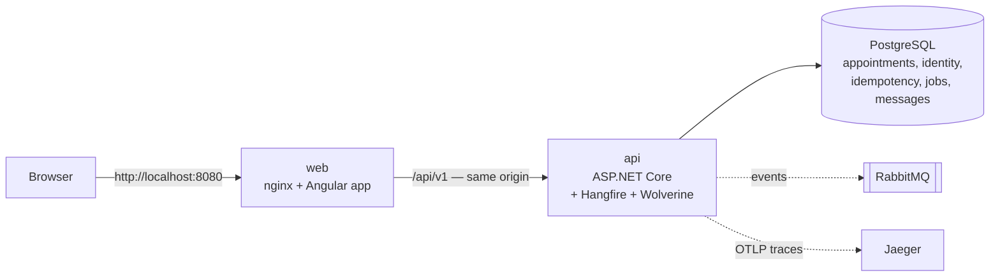

# Clinic Appointment Scheduler

Receptionists book patients with doctors in 30-minute slots — **without double-booking**, even when two people book the
same slot at the same moment. Doctors see their own day; admins manage users.
.NET 10 · ASP.NET Core · EF Core · PostgreSQL · RabbitMQ (Wolverine) · Hangfire · OpenTelemetry → Jaeger · Angular 22.

- **[SPEC.md](SPEC.md)** — requirement, data model, APIs, where conflict checking lives, time zones, concurrency
- **[PROMPTS.md](PROMPTS.md)** — prompts used with Claude Code and what was accepted / changed / rejected
- **[Documentation map](#documentation-map)** — requirements, architecture with Mermaid diagrams per feature, specs, ADRs

## How it works

- The **Angular app** shows a doctor's day in the clinic's time zone (Europe/London) and calls the API with a short-lived
  JWT; a rotating refresh token lives in an HttpOnly cookie.
- The **API** is a Clean Architecture .NET app (Domain ← Application ← Infrastructure ← Api). A booking is validated, checked
  against the business rules, pre-checked for overlaps, and saved in one transaction with its audit row. PostgreSQL
  **exclusion constraints** are the final guard, so a concurrent double-booking becomes `409 DOCTOR_CONFLICT`.
- Every POST carries an **`Idempotency-Key`**, so a retried booking returns the first answer instead of booking twice.
  Requests are **rate-limited** per user (Polly), and errors come back in one `ApiResponse` envelope with a stable
  `errorCode`.
- **Hangfire** runs clean-up jobs inside the API; **Wolverine** keeps a PostgreSQL message store and uses RabbitMQ when it is
  up (the API keeps working without it). Every request is **traced** to Jaeger.

## Quick start — Docker only
Prerequisite: **Docker Desktop** (or Docker Engine + Compose v2) running, ~4 GB free disk. Nothing else to install.

```bash
git clone <this repository> appointment-scheduler
```
```bash
cd appointment-scheduler
```
```bash
docker compose up --build -d
```
The first build downloads the .NET and Node images and takes a few minutes; later starts take seconds. Optional: copy
`.env.example` to `.env` first to change ports or passwords (every value has a default).

Check that everything is up (`api` and `web` show `running`, the infrastructure `healthy`):
```bash
docker compose ps
```
Then open **http://localhost:8080** and sign in with a demo user (fictional data, password `DemoClinic2026`):

| E-mail | Role | Sees |
|---|---|---|
| `admin@clinic.test` | Admin | everything, incl. user admin API |
| `reception@clinic.test` | Receptionist | full schedule: book / reschedule / cancel |
| `doctor@clinic.test` | Doctor (Dr. Amelia Hart) | own day schedule, read-only |

On first start the API creates the database schema and seeds 4 doctors, 12 patients (`MRN-0001`…`MRN-0012`) and a few
appointments **today and tomorrow**, so the schedule isn't empty.

| What | URL |
|---|---|
| The app | http://localhost:8080 |
| API reference (Scalar) / OpenAPI JSON | http://localhost:5080/scalar · http://localhost:5080/openapi/v1.json |
| API health | http://localhost:5080/health/live |
| Traces (Jaeger, service `appointment-scheduler-api`) | http://localhost:16686 |
| RabbitMQ management (`guest` / `guest`) | http://localhost:15672 |
| Database UI: pgAdmin, optional (`docker compose --profile tools up -d pgadmin`) | http://localhost:5050 |
| PostgreSQL (`scheduler` / `P@ssword!`, db `scheduler`) — e.g. pgAdmin, see below | localhost:5432 |

The Docker stack is a **local demo**: the API runs in the Development environment (migrates on start, seeds demo users,
uses a dev-only JWT key). Never deploy it as is.

### Everyday commands
| Task | Command |
|---|---|
| Follow the API log | `docker compose logs -f api` |
| Stop everything (keeps data) | `docker compose stop` |
| Start again | `docker compose up -d` |
| Rebuild after changing code | `docker compose up --build -d api web` |
| Reset all data (fresh seed) | `docker compose down -v` then `docker compose up -d` |

### Browse the database with pgAdmin
**Easiest: pgAdmin in Docker.** It's ready to use, with nothing to fill in:
```bash
docker compose --profile tools up -d pgadmin
```
Open **http://localhost:5050**. There's no pgAdmin login, and **Servers → AppointmentScheduler** connects without a
password prompt. Select **Databases → scheduler**, then **Tools → Query Tool** (Alt+Shift+Q).
- The server is defined in `tools/pgadmin/servers.json`, with `gssencmode=disable` and its password written from
  `POSTGRES_PASSWORD` at start.
- It listens on `127.0.0.1` only, and starts only with `--profile tools`, so `docker compose up` doesn't run it.
- Stop it with `docker compose stop pgadmin`.

**pgAdmin desktop** (Query Tool workspace ad-hoc connection, or *Register → Server*):

| Field | Value |
|---|---|
| Server name | any label, e.g. `AppointmentScheduler (local)` |
| Host name/address | `localhost` (not `.`, which is SQL Server syntax) |
| Port | `5432` (or your `POSTGRES_PORT`) |
| Database | `scheduler` |
| User / Password | `scheduler` / `P@ssword!` |
| Role, Service | leave empty |
| SSL mode | `prefer` or `disable` (the local container has no TLS) |
| Connection parameter **GSS encryption mode** (`gssencmode`) | **`disable`**: pgAdmin **9.18 on Windows** otherwise crashes with `exception: access violation writing 0x0000000000000000` ([pgadmin4#10428](https://github.com/pgadmin-org/pgadmin4/issues/10428)) |

The tables are in four schemas:
- `public`: `appointments`, `doctors`, `patients`, `audit_records`, `idempotency_records`;
- `identity`: `users`, `roles`, `refresh_tokens`;
- `hangfire`;
- `wolverine`.

Look, don't change: the app owns this data (use the API or the UI).

## Using it
1. Pick a doctor and a date (times are shown in the clinic zone, Europe/London).
2. Click a **Free** slot → search a patient (e.g. "Nora" or `MRN-0002`) → reason → **Review** → **Confirm**.
3. In **Day schedule**: **Reschedule** (pick a new free slot; slots where the patient is busy elsewhere are marked) or **Cancel**.

## Local development (option B)
For working on the code with hot reload. Needs **.NET SDK 10.0.4xx** (`global.json`) and **Node.js 24 / npm 11**.
Stop the app containers first, because they use the same ports:
```bash
docker compose stop api web
```
Start only the infrastructure, then the API and the web app (three terminals):
```bash
docker compose up -d postgres rabbitmq jaeger
```
```bash
dotnet run --project src/AppointmentScheduler.Api
```
```bash
cd web && npm install && npm start
```
Open **http://localhost:4200** (the dev server proxies `/api` to the API on :5080). The Hangfire dashboard is available in
this mode only, at http://localhost:5080/hangfire (it accepts local requests only).

## Tests
```bash
dotnet test
```
Runs unit tests (domain rules, DST, use cases with fakes) and architecture tests (layer rules). No Docker needed: there are
no integration tests by design (plan 011). Behaviour that needs a real database or HTTP host (the exclusion constraints,
idempotency replay, rate limits) is checked live against the running API. Load testing is done outside the repo.

The Angular app has no unit tests for now (plan 016). It is checked by its production build and by using the changed
screens in the browser:
```bash
cd web && npm run build
```

## Troubleshooting
| Symptom | Fix |
|---|---|
| `port is already allocated` | Another process uses 8080 / 5080 / 5432 / 5672 / 15672 / 16686. Stop it, or set `WEB_PORT`, `API_PORT`, `POSTGRES_PORT` in `.env`. |
| Signed in, but every page bounces back to login | Use Chrome, Edge or Firefox: the refresh cookie is `Secure`, which Safari rejects on `http://localhost`. |
| `api` keeps restarting | `docker compose logs api`. Usually PostgreSQL isn't healthy yet, or its volume holds an older schema: `docker compose down -v`. |
| `password authentication failed for user "scheduler"` | `POSTGRES_PASSWORD` applies only when the data volume is created. For an older volume, keep the data and set the password: `docker compose exec postgres psql -U scheduler -d scheduler -c "ALTER USER scheduler WITH PASSWORD 'P@ssword!';"` (or reset with `docker compose down -v`). |
| Log says RabbitMQ is unavailable / degraded mode | The app still works (messages stay in PostgreSQL). Start the broker: `docker compose up -d rabbitmq`. |
| `429 RATE_LIMITED` on login | Five logins per minute per IP. Behind the Docker nginx all browsers share one IP (no `ForwardedHeaders` yet, S-61); wait a minute. |
| `/hangfire` returns 401 in Docker | The dashboard accepts local requests only; use local development (option B). |
| `jaeger` fails: `Bind for 0.0.0.0:4317 failed` | Another Jaeger or OpenTelemetry collector already uses 4317/16686. Stop it, or ignore: tracing is optional and the app starts without it. |
| API log shows `Error: libgssapi_krb5.so.2: cannot open shared object file` | Harmless: the PostgreSQL driver probes for Kerberos support, which isn't used. |

## Configuration (`src/AppointmentScheduler.Api/appsettings.json`)
Environment variables override any key with `__` instead of `:` (e.g. `ConnectionStrings__Scheduler`); the Docker values are
in `docker-compose.yml`.

| Key | Default | Meaning |
|---|---|---|
| `ConnectionStrings:Scheduler` | localhost:5432, db `scheduler` | PostgreSQL |
| `Clinic:TimeZone` | `Europe/London` | IANA zone of the clinic |
| `Clinic:Open` / `Clinic:Close` / `Clinic:SlotMinutes` | `09:00` / `17:00` / `30` | Opening hours and slot size |
| `Seed:Enabled` | `true` | Seed fictional data on an empty database (demo users only in Development) |
| `Jwt:SigningKey` (env `Jwt__SigningKey` / `JWT_SIGNING_KEY`) | dev-only value in `appsettings.Development.json` | ≥ 32-byte HS256 key; never commit a real one |
| `BackgroundJobs:Enabled` | `true` | Run the Hangfire server and recurring jobs in the API process |
| `Idempotency:RecordTtlHours` / `InProgressTimeoutSeconds` | `24` / `60` | How long a key is remembered; when a stuck in-progress key may be taken over |
| `RateLimiting:Enabled` / `ConcurrentRequests` | `true` / `200` | Polly rate-limit pipelines on / global concurrency cap (ADR-0009) |
| `RateLimiting:Reads` / `Writes` / `Auth` | 300/min sliding · burst 10 + 1 per 2 s · 5/min per IP | Per-user (or IP) limits; 429 `RATE_LIMITED` + `Retry-After` |
| `Observability:ServiceName` | `appointment-scheduler-api` | OpenTelemetry service name (as shown in Jaeger) |
| `Observability:OtlpEndpoint` (env `Observability__OtlpEndpoint`) | empty; `http://localhost:4317` in Development | OTLP traces target (Jaeger); empty = no export |
| `Observability:MetricsEndpoint` | empty | OTLP metrics target (Jaeger has no metrics); empty = no export |
| `Messaging:RabbitMq:Enabled` / `Host` / `Port` / `UserName` / `Password` | `true` / `localhost` / `5672` / `guest` / `guest` in Development (local Docker only) | RabbitMQ for Wolverine; `Enabled=false` = PostgreSQL message store only |
| `Messaging:Publishing:Exchange` | `appointment-scheduler.events` | Topic exchange for integration events (declared at startup) |
| `Messaging:RecoveryIntervalMinutes` / `RestartOnRecovery` | `1` / true outside Development | Degraded mode: re-check the broker, then restart the host to attach it |

## Project layout
```
src/AppointmentScheduler.Domain          rules: Appointment, DaySchedule; repository + unit-of-work contracts (no dependencies)
src/AppointmentScheduler.Application     use cases: AppointmentService, AvailabilityService, LookupQueries, auth contracts
src/AppointmentScheduler.Infrastructure  EF Core + Npgsql, repositories, migrations (exclusion constraints), Identity, Hangfire, Wolverine
src/AppointmentScheduler.Api             controllers, error envelope, idempotency, rate limiting, OpenAPI; Dockerfile
tests/                                   Unit, Architecture
web/                                     Angular app; Dockerfile + nginx.conf
docs/                                    specs, ADRs, architecture, SDLC, backlog
.claude/                                 Claude Code rules, agents (SDLC roles), skills and saved plans
```

## Documentation map
| Want to know… | Read |
|---|---|
| What the system must do, feature by feature, with status, code and how it's verified | [docs/requirements/functional.md](docs/requirements/functional.md) |
| How well it must do it (correctness, security, resilience, observability, …) | [docs/requirements/non-functional.md](docs/requirements/non-functional.md) |
| How it is built: containers, deployment, layers, data model, request pipeline | [docs/architecture.md](docs/architecture.md) |
| One feature's components and flows (Mermaid diagrams) | [docs/architecture/](docs/architecture) — e.g. [booking](docs/architecture/booking.md), [idempotency](docs/architecture/idempotency.md) |
| Exact acceptance criteria (Given/When/Then) | [docs/specs/](docs/specs) |
| Why a technical decision was made | [docs/adr/](docs/adr) |
| The short graded spec (API table, error codes, conflict checking, time zones) | [SPEC.md](SPEC.md) |
| What's next | [docs/backlog.md](docs/backlog.md) |

## Not covered by the Docker stack yet (backlog S-61)
`ForwardedHeaders` behind nginx (per-client rate limits), a separate migration step instead of migrate-on-start, and a
production configuration (real secrets, HTTPS, no demo users).

## Working on it with Claude Code
`CLAUDE.md` holds the project rules. Project skills: `/sdlc <feature>` (full role-agent ceremony, `--fast` for small
changes), `/new-feature`, `/add-migration`, `/verify`, `/log-prompt`. See [docs/sdlc.md](docs/sdlc.md).
