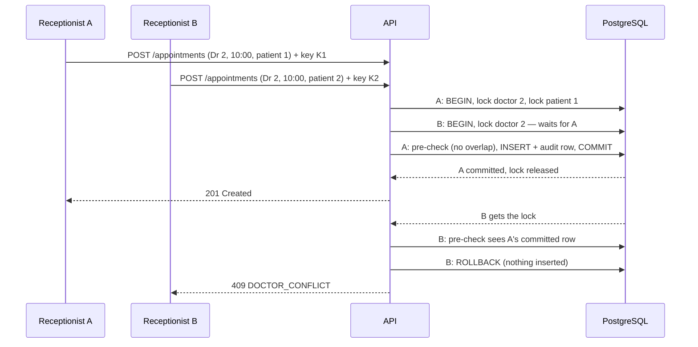

# SPEC — Clinic Appointment Scheduler

Short graded specification. Detail lives in [`docs/specs`](docs/specs) (acceptance criteria) and [`docs/adr`](docs/adr) (decisions).
Every requirement with its status, code and verification: [functional](docs/requirements/functional.md) ·
[non-functional](docs/requirements/non-functional.md). Diagrams per feature: [docs/architecture.md](docs/architecture.md).

## 1. Requirement
A receptionist books patients with doctors and manages the day's schedule **without ever creating a conflicting appointment**.

| Flow | What the user does | Spec |
|---|---|---|
| Availability | Select doctor + date → see 30-min slots 09:00–17:00 (clinic time) as Free / Booked / Past / PatientBusy | [001](docs/specs/001-availability.md) |
| Book | Choose a free slot, a patient and a reason → review → confirm | [002](docs/specs/002-booking.md) |
| Manage | View the day's schedule, cancel, reschedule to another free slot | [003](docs/specs/003-manage-schedule.md) |

### Business rules
| ID | Rule | Enforced by |
|---|---|---|
| BR-1 | A doctor cannot have two overlapping Scheduled appointments | Service pre-check → **PostgreSQL exclusion constraint** |
| BR-2 | A patient cannot have two overlapping Scheduled appointments (any doctor) | Service pre-check → **PostgreSQL exclusion constraint** |
| BR-3 | No booking or rescheduling into the past | `Appointment` aggregate + injected `TimeProvider` |
| BR-4 | Start must be a slot on the 30-min grid inside opening hours | `DaySchedule.EnsureValidSlot` |
| BR-5 | Only future Scheduled appointments can be cancelled / rescheduled | `Appointment` aggregate |
| BR-7 | A Doctor-only user reads only their own schedule and changes nothing (M2) | Role policies + `ScheduleAccess` in `AppointmentService` |

## 2. Data model (PostgreSQL, snake_case)
```
doctors       (id PK, full_name, specialty)
patients      (id PK, mrn UNIQUE, full_name, date_of_birth, phone)              -- fictional data only
appointments  (id uuid PK (v7), doctor_id FK, patient_id FK,
               start_utc timestamptz, end_utc timestamptz, reason varchar(500),
               status 'Scheduled'|'Cancelled', created_at_utc, cancelled_at_utc, cancellation_reason,
               xmin → optimistic concurrency token)
  CHECK  end_utc > start_utc
  EXCLUDE USING gist (doctor_id  WITH =, tstzrange(start_utc, end_utc, '[)') WITH &&) WHERE status = 'Scheduled'
  EXCLUDE USING gist (patient_id WITH =, tstzrange(start_utc, end_utc, '[)') WITH &&) WHERE status = 'Scheduled'
  INDEX (doctor_id, start_utc), (patient_id, start_utc)
```
Cancel is a soft status change: history is kept and the `WHERE status = 'Scheduled'` makes the slot free again.

## 3. Main APIs (`/api/v1`, JSON, every body is an `ApiResponse<T>` envelope)
ASP.NET Core **controllers** (`Api/Controllers`), authenticated by default with a JWT bearer token (M2, [spec 004](docs/specs/004-auth.md)).
Each action declares every status it can return with `[ProducesResponseType]`, so `/scalar` shows the full contract.

Response envelope ([ADR-0015](docs/adr/0015-api-response-envelope.md)); members that don't apply are omitted:
```jsonc
// 201 POST /appointments
{ "isSuccess": true, "statusCode": 201, "message": "Appointment booked.",
  "data": { "id": "…", "localStart": "10:00", … }, "timestamp": "2026-10-19T14:46:27.99+00:00" }
// 409
{ "isSuccess": false, "statusCode": 409, "message": "The doctor already has an appointment at this time.",
  "errorCode": "DOCTOR_CONFLICT", "traceId": "00-…", "timestamp": "…" }
// 400 adds "errors": { "reason": ["…"] }; an unexpected 500 adds "errorDetails" in Development only
```
Reads without a specific message say "Request completed successfully".
`POST /auth/logout` is the one exception: **204** with no body.

**Idempotency** ([spec 009](docs/specs/009-idempotency.md)): every POST except `/auth/*` (and read-only POSTs such as a search) needs an
`Idempotency-Key` header (1–100 chars, a UUID per user action):
- a repeat with the same key and request replays the stored response with `Idempotent-Replayed: true`;
- the same key with a different request → 422;
- while the first request is still running → 409 + `Retry-After: 1`;
- keys live 24 h, per user.

**Versioning** ([ADR-0017](docs/adr/0017-api-versioning.md)): the version is in the URL (`/api/v1/…`); responses carry
`api-supported-versions`. An optional `X-Api-Version` header or `api-version` query must match the URL (else 400
`UNSUPPORTED_API_VERSION`). An unknown URL version such as `/api/v2/…` → 404 `UNSUPPORTED_API_VERSION`.

| Method | Route | Notes |
|---|---|---|
| POST | `/auth/login`, `/auth/refresh`, `/auth/logout` · GET `/me` | 15-min access token + rotating refresh cookie; login/refresh anonymous |
| POST / PUT | `/users`, `/users/{id}/roles` | Admin only |
| GET | `/clinic` | `{timeZone, today, opens, closes, slotMinutes}` — `today` is the clinic-local date the app opens on (§6) |
| GET | `/doctors` | list |
| GET | `/patients?search=&page=&pageSize=` | name contains / exact MRN, paged (≤100) |
| GET | `/doctors/{id}/availability?date=YYYY-MM-DD[&patientId=]` | `{timeZone, slots:[{startUtc,endUtc,localStart,status,appointmentId}]}` |
| GET | `/appointments?doctorId=&date=` | day schedule incl. cancelled |
| GET | `/appointments/{id}` | single appointment |
| POST | `/appointments` | `{doctorId, patientId, startUtc, reason}` → **201** + Location |
| POST | `/appointments/{id}/cancel` | `{reason?}` → 200 |
| POST | `/appointments/{id}/reschedule` | `{startUtc}` → 200 |

| Status | `errorCode` (constants in `Domain/Common/ErrorCodes.cs`) |
|---|---|
| 400 | `VALIDATION_FAILED` (field errors), `BAD_REQUEST` (malformed input) |
| 401 / 403 / 423 | `UNAUTHORIZED`, `INVALID_CREDENTIALS`, `INVALID_REFRESH_TOKEN`, `REFRESH_TOKEN_REUSED` / `FORBIDDEN` / `ACCOUNT_LOCKED` |
| 404 | `DOCTOR_NOT_FOUND`, `PATIENT_NOT_FOUND`, `APPOINTMENT_NOT_FOUND`, `USER_NOT_FOUND`, `ROUTE_NOT_FOUND` (no such URL) |
| 405 | `METHOD_NOT_ALLOWED` |
| 404 / 400 | `UNSUPPORTED_API_VERSION` (unknown URL version / mismatched header or query version) |
| 415 | `UNSUPPORTED_MEDIA_TYPE` (body is not JSON) |
| 400 / 409 / 422 | `IDEMPOTENCY_KEY_REQUIRED` / `IDEMPOTENCY_REQUEST_IN_PROGRESS` / `IDEMPOTENCY_KEY_REUSED` (spec 009) |
| 429 | `RATE_LIMITED` + `Retry-After` (Polly rate limits: login 5/min per IP, writes burst 10 then 30/min, reads 300/min per user — ADR-0009) |
| 409 | `DOCTOR_CONFLICT`, `PATIENT_CONFLICT`, `CONCURRENCY_CONFLICT`, `EMAIL_TAKEN` |
| 422 | `APPOINTMENT_IN_PAST`, `INVALID_SLOT`, `APPOINTMENT_NOT_MODIFIABLE` |
| 500 | `INTERNAL_ERROR` — generic message only; details go to the server log with the `traceId` |
| 503 | `SERVICE_UNAVAILABLE` + `Retry-After: 5` — the database is unreachable; nothing was half-saved (atomic unit of work, no server-side retry — ADR-0008); retry, with the same `Idempotency-Key` for writes |

Expected failures are `SchedulerException` subclasses that carry their own `ErrorCode`, `StatusCode` and a log-only
`LogDetail` (ids only). All of them become HTTP responses in one place, `Api/Errors/GlobalExceptionHandler.cs`; anything else
→ logged 500. JWT 401/403 and bodiless statuses (unknown route) are written by `ApiErrorWriter` in the same shape.

Interactive docs: `http://localhost:5080/scalar` (Development).

## 4. Where conflict checking lives — and why (judgment test)
**All three layers, each with a different job** ([ADR-0002](docs/adr/0002-postgres-exclusion-constraints.md)):

| Layer | What it does | Why it is there | Why it is not enough alone |
|---|---|---|---|
| **UI** | shows only Free slots as clickable; marks Booked / Past / PatientBusy | fast feedback, fewer failed requests | stale the moment it renders; any client can bypass it |
| **API** (`AppointmentService`) | validates, locks the doctor and patient (§5), then runs an overlap query before saving (BR-1 doctor, BR-2 patient) | a precise `409 DOCTOR_CONFLICT` / `PATIENT_CONFLICT` within milliseconds, nothing staged on rejection | protects only the code paths that take the lock; an import job or manual SQL would bypass it |
| **Database** | two `EXCLUDE USING gist` constraints over `tstzrange(start_utc, end_utc, '[)')` for `status = 'Scheduled'` (doctor, patient) | **the guarantee**: PostgreSQL rejects any overlapping row atomically, for every write path (service, migration, manual SQL) | — (its error, SQLSTATE `23P01`, is translated to the same 409 codes, so clients see one behaviour) |

The constraint is **range-based**, so it stays correct when durations vary (appointment types, spec 006). The half-open
`[)` range lets 09:00–09:30 and 09:30–10:00 coexist. Cancelled rows are excluded, so a cancelled slot is free again.

**Rejected alternatives**
| Option | Why not |
|---|---|
| UI check only | trusts the client; stale data; bypassed by any second tab or API client |
| API check only | without a lock, two requests both pass the check before either commits; with a lock (§5) it's correct only for paths that take it |
| `UNIQUE (doctor_id, start_utc)` | catches only identical starts, not partial overlaps (09:00–10:00 vs 09:30–10:00); needs a partial index to ignore cancelled rows; breaks once durations vary |
| Trigger that checks overlaps | procedural re-implementation of what `EXCLUDE` does declaratively; easy to get wrong under concurrency without locks |

## 5. Concurrent bookings of the same slot
**Finding that shaped the design.** With only the pre-check and the constraint, 8 parallel bookings of one slot gave
exactly one booking, so the guarantee held, but the other 7 got **503 after up to 7 s**. PostgreSQL logged
`deadlock detected`: with an exclusion constraint, each concurrent INSERT writes its row first and then waits for the other
in-progress conflicting rows. The waits form a cycle, and PostgreSQL aborts one victim per `deadlock_timeout` (1 s).
Correct, but a bad answer.

**Decision: lock → pre-check → insert, in one transaction; the constraint stays the guarantee.** Book and reschedule run
in `IUnitOfWork.ExecuteInTransactionAsync`:
1. Take `pg_advisory_xact_lock` on the **doctor**, then the **patient**. The order is always the same, so these locks
   can't deadlock (`AppointmentRepository.LockScheduleAsync`).
2. Run the pre-check (BR-1, BR-2).
3. Stage the appointment and its audit row, then commit. Commit or rollback releases the locks.


Measured with the "See it yourself" block below: **1×201 and 7×409 `DOCTOR_CONFLICT` in about 0.4 s for all eight, with no
deadlock logged**. Before the fix it was 503s after up to 7 s.

- **What each user sees:**
  - the winner gets `201`;
  - the loser gets `409 DOCTOR_CONFLICT` ("The doctor already has an appointment at this time."), or `PATIENT_CONFLICT`
    when the patient is the overlap. The booking dialog closes, the message shows, and the slot grid reloads with the
    slot now Booked;
  - nothing is half-saved: a rejected booking inserts no appointment and no audit row.
- **Why the constraint still matters:** any write that skips the lock (a future import job, manual SQL) is still rejected
  by `EXCLUDE` (23P01 → the same 409).
- **If such a write deadlocks:**
  - PostgreSQL aborts it with 40P01;
  - `AppDbContext` maps that to `409 CONCURRENCY_CONFLICT` ("Someone else changed this schedule at the same moment"),
    because it is a concurrency conflict, not a database outage (503);
  - the UI reloads the grid on it.
- **A retry is not a conflict.** The same receptionist double-clicking, or a network retry, resends the **same**
  `Idempotency-Key`, and the API replays the first `201` instead of answering `409` ([spec 009](docs/specs/009-idempotency.md)).
  Only *different* user actions compete for a slot.
- **Concurrent changes to one appointment** (cancel vs reschedule) use PostgreSQL `xmin` as an optimistic concurrency token.
  The second writer gets `409 CONCURRENCY_CONFLICT` instead of overwriting the first ([ADR-0004](docs/adr/0004-concurrency-etag.md)).
  `ETag` / `If-Match` on these endpoints (S-31) is set aside; `xmin` already prevents the lost update.
- **Cost:** bookings for the *same doctor or the same patient* queue behind each other for the few milliseconds of one
  transaction. Other doctors and patients are unaffected. The default *Read Committed* isolation is enough: after the
  lock, each statement sees everything committed.

**Rejected alternatives**
| Option | Why not |
|---|---|
| Constraint only (no lock) | correct, but concurrent conflicting inserts deadlock: losers wait about 1 s each and get an error instead of a clear 409 (measured above) |
| `SERIALIZABLE` transactions | correct, but conflicting transactions abort with serialization failures that must be retried everywhere; costlier, and the error is less precise |
| `SELECT … FOR UPDATE` on the doctor row | the same idea as the advisory lock, but it needs a row to lock for the patient too, and it holds real row locks that block other updates of the doctor |
| In-process lock (`SemaphoreSlim` per doctor) | breaks as soon as there are two API instances, and protects nothing written outside the API |
| Retry on deadlock | a retry loop for the database was ruled out (ADR-0008: atomic unit of work, no DB retry), and it would only hide the cause |

**See it yourself.** This is the live check that replaces the removed integration test (plan 011). With the app running
(Docker or local), it fires 8 parallel bookings of one free slot, each from a different patient with its own key:
```bash
API=http://localhost:5080/api/v1
TOKEN=$(curl -s -X POST $API/auth/login -H 'Content-Type: application/json' \
  -d '{"email":"reception@clinic.test","password":"DemoClinic2026"}' | sed -E 's/.*"accessToken":"([^"]+)".*/\1/')
SLOT=$(curl -s "$API/doctors/2/availability?date=2030-01-07" -H "Authorization: Bearer $TOKEN" \
  | grep -o '"startUtc":"[^"]*","endUtc":"[^"]*","localStart":"[^"]*","status":"Free"' | head -1 \
  | sed -E 's/"startUtc":"([^"]+)".*/\1/')
for i in $(seq 8); do
  curl -s -o /dev/null -w '%{http_code}\n' -X POST $API/appointments -H "Authorization: Bearer $TOKEN" \
    -H 'Content-Type: application/json' -H "Idempotency-Key: race-$RANDOM-$i" \
    -d "{\"doctorId\":2,\"patientId\":$i,\"startUtc\":\"$SLOT\",\"reason\":\"race check\"}" &
done | sort | uniq -c
```
Expected output: `1 201` and `7 409`. The winning booking is real, so cancel it in the app afterwards, or run it again: the
next free slot is used. Eight stays inside the per-user write burst of 10 (§3 rate limits).

## 6. Time zones
([ADR-0003](docs/adr/0003-time-zones.md))

**The rules**
- Instants are stored as UTC `timestamptz` only (`start_utc`, `end_utc`).
- "09:00–17:00" is clinic wall-clock time in a configured IANA zone (`Clinic:TimeZone`, default `Europe/London`, which has
  DST).
- Slots are generated in local time for the requested *clinic-local* date and converted to UTC on the server.
- The API returns `startUtc` plus `localStart` and `timeZone`. The UI displays `localStart` and posts back `startUtc`, so it
  never converts zones itself.
- Day boundaries (`?date=`) are clinic-local days.
- The app opens on the clinic's **today**, from `GET /clinic`, not the browser's date. At 20:00 in New York it is already
  tomorrow in London, and the receptionist must see London's day (FR-001-8).
- "Now" comes from an injected `TimeProvider`, so past/future rules are deterministic in tests (`FakeTimeProvider`).

**DST, worked example (London)**
| Clinic date | 09:00 local is | First slot `startUtc` |
|---|---|---|
| Sat 2026-03-28 (GMT, UTC+0) | 09:00 GMT | `2026-03-28T09:00:00Z` |
| Sun 2026-03-29 (BST starts at 01:00, UTC+1) | 09:00 BST | `2026-03-29T08:00:00Z` |
| Sun 2026-10-25 (BST ends at 02:00, back to UTC+0) | 09:00 GMT | `2026-10-25T09:00:00Z` |

The receptionist always sees 09:00–16:30; only the UTC instants move (`DayScheduleTests.AC_001_6…`). London's switches
happen at 01:00/02:00, outside opening hours. `DaySchedule` still skips wall-clock times that don't exist (spring gap) and
maps ambiguous ones (autumn overlap) to the standard offset, so other zones or early opening hours stay correct.

**Rejected alternatives**
| Option | Why not |
|---|---|
| Store local time (+ zone) | ambiguous in the autumn overlap hour; rows from different zones can't be compared or ordered; the patient rule (BR-2) needs instants |
| Convert in the browser | depends on the receptionist's zone and the client's time-zone data, so two browsers could show different days |
| Store fixed UTC offsets (e.g. `+00:00`) | correct for half the year only; DST changes the offset |

Multiple clinics in different zones (spec 007) keep the same rules: each clinic has its own IANA zone, and BR-2 compares
UTC ranges across clinics.

## 7. Architecture
Clean Architecture ([ADR-0001](docs/adr/0001-clean-architecture.md)): `Domain` (rules + repository / unit-of-work
contracts) ← `Application` (use cases, no EF Core) ← `Infrastructure` (EF Core/Npgsql repositories, unit of work, constraint →
error translation, seed; [ADR-0016](docs/adr/0016-repository-unit-of-work.md)) ← `Api` (thin controllers, global exception
handler, auth; responses are `ApiResponse<T>`, [ADR-0015](docs/adr/0015-api-response-envelope.md)). The Api is the only host: background jobs run in it via **Hangfire** ([ADR-0014](docs/adr/0014-hangfire-background-jobs.md),
PostgreSQL storage, hourly expired-refresh-token purge). Layer rules are enforced by `ArchitectureTests`. Frontend: Angular 22 +
Material, feature folders `features/schedule` and `features/auth`.

## 8. Beyond the brief (roadmap, specs written)
The repository is set up as a production simulation; these are specified and planned as later milestones
([backlog](docs/backlog.md)): authentication/roles (004 — **built in M2**), patient CRUD (005), working hours/breaks/time off/appointment types
(006), multiple clinics & time zones (007), notifications via Wolverine + RabbitMQ outbox (008), idempotency keys (009),
rate limiting, resilience, OpenTelemetry → Jaeger. Non-functional targets: [000-nfr](docs/specs/000-nfr.md).

## 9. Out of scope (for the challenge milestone)
Authentication, doctor-specific hours, multi-clinic, patient editing, notifications — see §8.
