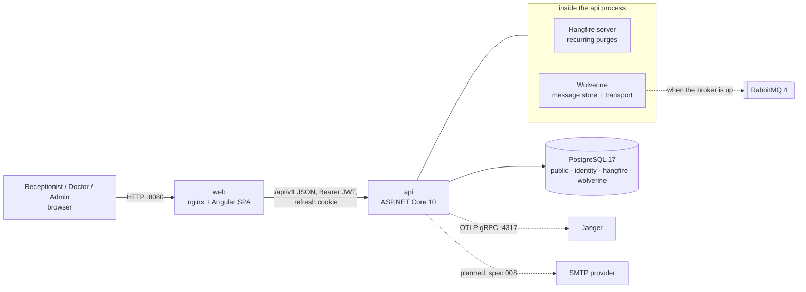
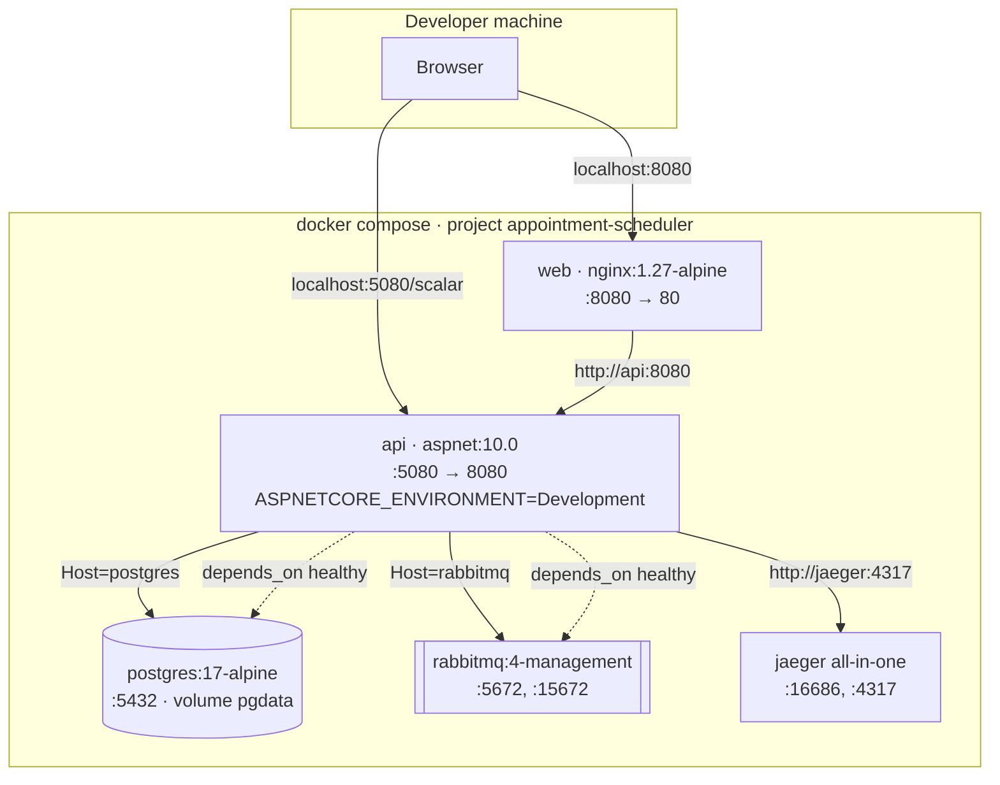
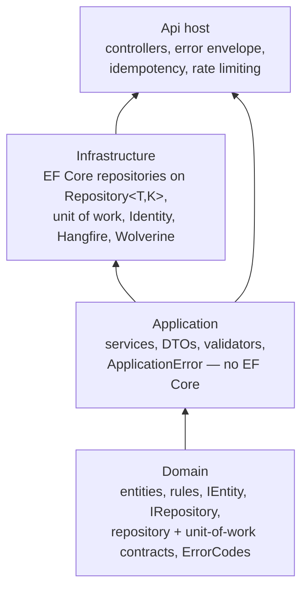
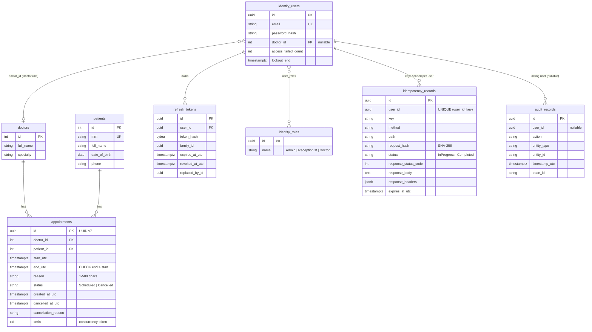
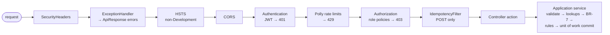

# Architecture

The system overview: containers, deployment, layers, data model, host composition and the request pipeline. Each feature has its
own page with component, sequence and state diagrams:

| Feature | Page | Status |
|---|---|---|
| Availability (spec 001) | [architecture/availability.md](architecture/availability.md) | ✅ |
| Booking (spec 002) | [architecture/booking.md](architecture/booking.md) | ✅ |
| Manage the day's schedule (spec 003) | [architecture/manage-schedule.md](architecture/manage-schedule.md) | ✅ |
| Authentication, users and audit (spec 004) | [architecture/auth-and-users.md](architecture/auth-and-users.md) | ✅ |
| Doctor and patient lookups (spec 005) | [architecture/lookups.md](architecture/lookups.md) | 🟡 search built, CRUD planned |
| Idempotent writes (spec 009) | [architecture/idempotency.md](architecture/idempotency.md) | ✅ |
| Rate limiting (ADR-0009) | [architecture/rate-limiting.md](architecture/rate-limiting.md) | ✅ |
| Errors and resilience (ADR-0008, ADR-0015) | [architecture/errors-and-resilience.md](architecture/errors-and-resilience.md) | ✅ |
| Background jobs (ADR-0014) | [architecture/background-jobs.md](architecture/background-jobs.md) | ✅ |
| Messaging and notifications (ADR-0007, spec 008) | [architecture/messaging.md](architecture/messaging.md) | 🟡 wiring built, notifications planned |
| Observability (ADR-0010) | [architecture/observability.md](architecture/observability.md) | ✅ traces |
| Doctor schedules (spec 006) | [architecture/doctor-schedules.md](architecture/doctor-schedules.md) | 📋 planned |
| Clinics and time zones (spec 007) | [architecture/clinics-timezones.md](architecture/clinics-timezones.md) | 📋 planned |

The requirements behind these pages are catalogued in [requirements/functional.md](requirements/functional.md) and
[requirements/non-functional.md](requirements/non-functional.md).

## Containers

- **web** is the Angular production build served by nginx, which proxies `/api/` to the API on the same origin (no CORS).
  In local development the Angular dev server on :4200 does the same proxying.
- **api** is the only host: controllers, Hangfire background jobs and Wolverine messaging all run in this one process
  ([ADR-0014](adr/0014-hangfire-background-jobs.md), [ADR-0007](adr/0007-wolverine-outbox-rabbitmq.md)).
- **PostgreSQL** holds everything durable. Its schemas are `public` (scheduling, audit, idempotency), `identity` (users,
  roles, refresh tokens), `hangfire` and `wolverine`.
- **RabbitMQ** is optional at runtime: without it Wolverine runs in degraded mode on its PostgreSQL store.

## Deployment (Docker Compose, local demo)

The images are built from `src/AppointmentScheduler.Api/Dockerfile` (context: the repository root) and `web/Dockerfile`.
Development mode makes this a demo stack: it migrates on start, seeds fictional data and demo users, and uses the dev-only JWT
key. Not done yet (S-61): a separate migrator, `ForwardedHeaders` behind nginx, and a production configuration.
An optional `pgadmin` service (profile `tools`, http://localhost:5050, 127.0.0.1 only) gives a pre-connected database UI
(plan 017).

## Layers

Arrows point from a project to the projects that depend on it. `ArchitectureTests` enforce the rules:
- the Api uses Application and Infrastructure only, never Domain types (`ApplicationError`, Application DTOs and enums);
- Application has no EF Core;
- repositories are reached only through `IUnitOfWork`, every contract extends `IRepository<TEntity, TKey>`, and every
  implementation inherits `Repository<TEntity, TKey>` ([ADR-0016](adr/0016-repository-unit-of-work.md)).

Identity types live in `Microsoft.AspNetCore.Identity`, so Identity stays in Infrastructure. Application owns the auth
contracts (`IAuthService`, `IUserAdminService`, `ICurrentUser`, `AuditLog`).

## Data model

`appointments` carries two `EXCLUDE USING gist` constraints over `tstzrange(start_utc, end_utc, '[)')`, one per doctor and
one per patient, for *Scheduled* rows only ([ADR-0002](adr/0002-postgres-exclusion-constraints.md)). Cancelling is a soft
status change, so history is kept. The `hangfire` and `wolverine` schemas are owned by those libraries.

## Host composition (`Api/Program.cs`)
`Program.cs` only composes. Each concern has one `public static class <Concern>Config` in `Api/Configuration/`, written as
C# 14 extension blocks:
- `extension(WebApplicationBuilder builder) { public WebApplicationBuilder Add<Concern>Configuration() … }` for services;
- `extension(WebApplication app) { … }` for that concern's pipeline or mapping helpers.

Each layer registers its own services:

| Call | File | Registers |
|---|---|---|
| `AddApiConfiguration()` | `Api/Configuration/ApiConfig.cs` | `ClinicOptions` (validated on start), `TimeProvider`, `AddApplication()`, `AddInfrastructure()`, controllers, JSON, model-state 400, `IClientErrorFactory` + `IProblemDetailsWriter` (both → `ApiResponse`), `GlobalExceptionHandler`, `AddProblemDetails`, health checks, the global `IdempotencyFilter`; app side `UseApiExceptionHandling()` |
| ↳ `AddApplication()` | `Application/DependencyInjection.cs` | services, `AuditLog`, validators |
| ↳ `AddInfrastructure()` | `Infrastructure/DependencyInjection.cs` | `AddPersistence` (DbContext, seed, unit of work — which owns the repositories, idempotency store), `AddIdentityAndJwt`, `AddBackgroundJobs` (Hangfire) |
| `AddSecurityConfiguration()` | `Api/Configuration/SecurityConfig.cs` | role policies + JWT 401/403 bodies (`AddApiAuth`), HSTS, CORS from `Cors:AllowedOrigins` |
| `AddMessagingConfiguration()` | `Api/Configuration/MessagingConfig.cs` → `Infrastructure/Messaging/MessagingSetup.cs` | Wolverine: PostgreSQL message store (schema `wolverine`), EF Core transactions, RabbitMQ transport when the startup probe succeeds, otherwise degraded mode + `RabbitMqRecoveryService` (ADR-0007) |
| `AddApiVersioningConfiguration()` | `Api/Configuration/ApiVersioningConfig.cs` | Asp.Versioning: v1 default, URL segment + `X-Api-Version` + `api-version`, reported versions, API explorer groups (ADR-0017) |
| `AddOpenApiConfiguration()` | `Api/Configuration/OpenApiConfig.cs` | OpenAPI document (+ `Idempotency-Key` header on POSTs); app side `MapOpenApiDocs()` → `/openapi/v1.json`, `/scalar` |
| `AddObservabilityConfiguration()` | `Api/Configuration/ObservabilityConfig.cs` | OpenTelemetry traces (ASP.NET Core, HttpClient, EF Core, Wolverine) → OTLP/Jaeger; metrics → OTLP when configured (ADR-0010) |
| `AddRateLimitingConfiguration()` | `Api/Configuration/RateLimitingConfig.cs` | Polly pipelines `rate-limit:global/reads/writes/auth` (concurrency + partitioned limiters); app side `UseRateLimitingConfiguration()` after authentication (ADR-0009) |

On the app side, `ApplyMigrationsAsync()` runs first (Development only), then the middleware below in order, then
`MapControllers`, `MapHealthChecks("/health/live")`, then `UseBackgroundJobs()` (recurring jobs + Development-only
`/hangfire`). The middleware order stays written out in `Program.cs` on purpose, so it can be read in one place.

## API request pipeline

Every framework-made error has the same `ApiResponse` shape, and its `errorCode` comes from `Api/Errors/ErrorStatusMapping`:
- bodiless statuses (404/405) go through `IProblemDetailsService` → `ApiResponseProblemDetailsWriter`;
- MVC client errors (415) go through `ApiResponseClientErrorFactory`.

Details: [errors-and-resilience.md](architecture/errors-and-resilience.md).
