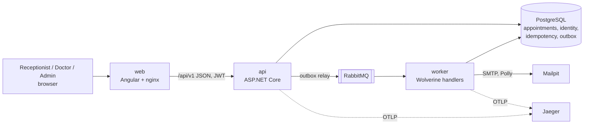
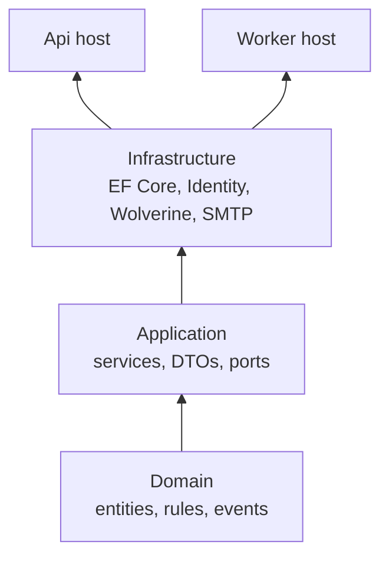
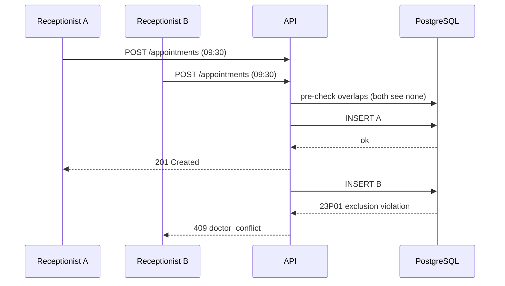
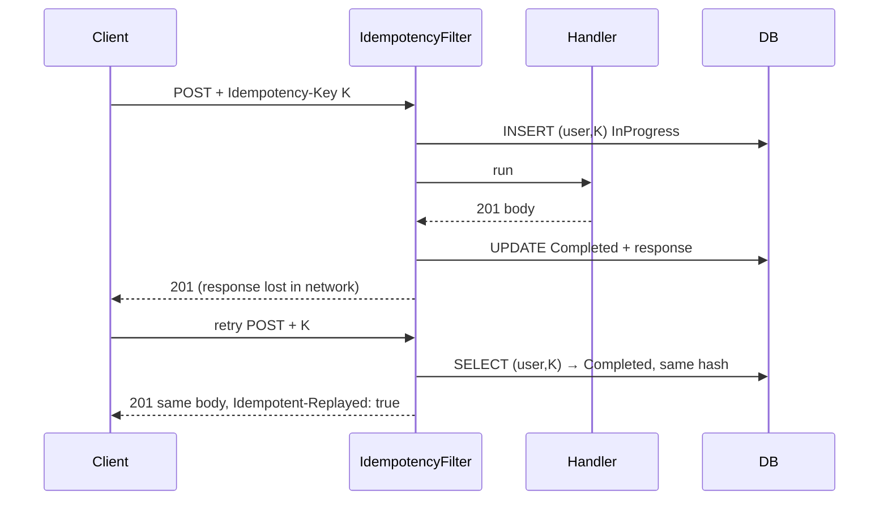
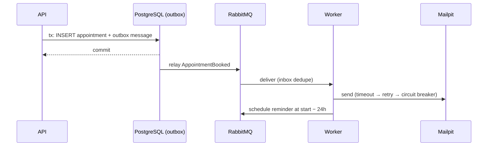

# Architecture

## Containers

## Layers

Arrows point from a project to the projects that depend on it. Enforced by `ArchitectureTests`.

## Booking a slot (happy path + race)

## Idempotent retry

## Notification flow

