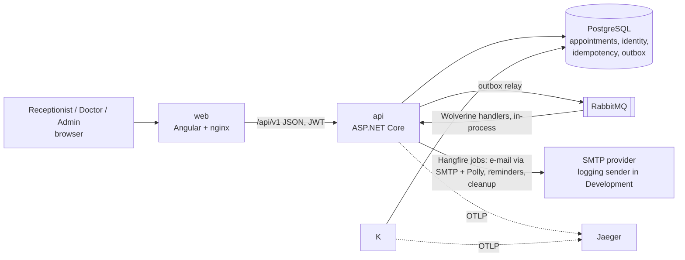
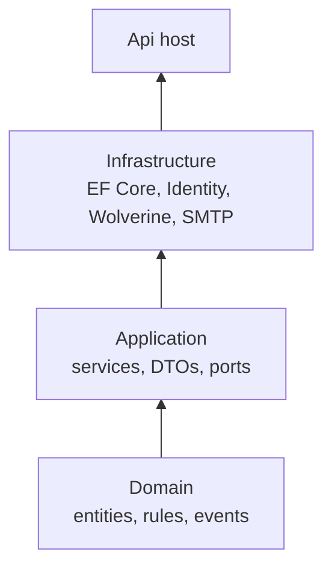
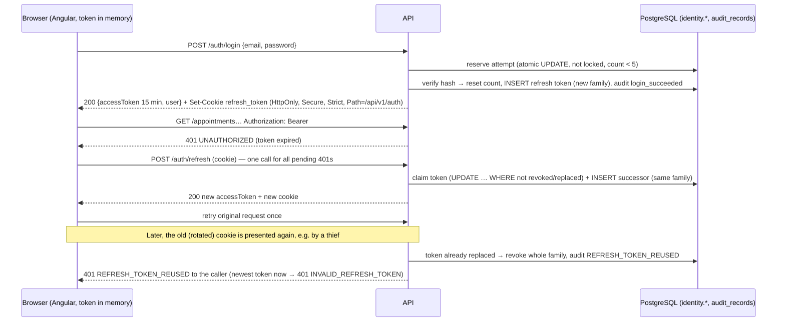
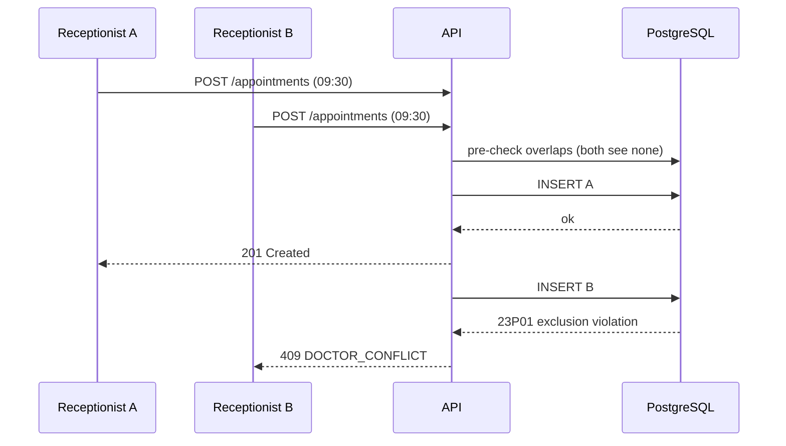
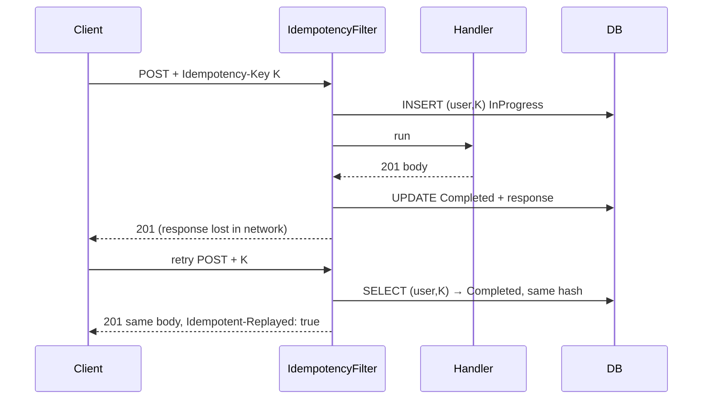
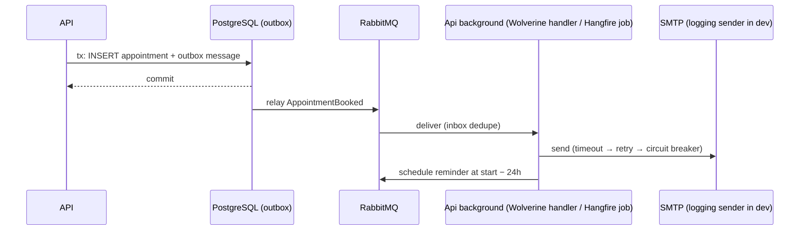

# Architecture

## Containers

## Layers

Arrows point from a project to the projects that depend on it. Enforced by `ArchitectureTests`.
Identity types live in `Microsoft.AspNetCore.Identity`, so Identity stays in Infrastructure; Application owns the auth
contracts (`IAuthService`, `IUserAdminService`, `ICurrentUser`, `AuditLog`) — spec 004.

## API request pipeline (M2)
`SecurityHeaders` → `ExceptionHandler` (`SchedulerException` → `ApiResponse` error with `errorCode`, ADR-0015) → `StatusCodePages` (bodiless 404/405 → `ApiResponse`) → `Hsts` (non-Development)
→ `Cors` → `Authentication` (JWT, 401 `UNAUTHORIZED`) → `Authorization` (role policies, 403 `FORBIDDEN`) → endpoint
(bind → Application service: validate → lookups → BR-7 check → rules → one `SaveChanges` incl. audit row).

## Sign-in, refresh rotation and reuse detection (spec 004, ADR-0005)

## Booking a slot (happy path + race)

## Idempotent retry

## Notification flow

