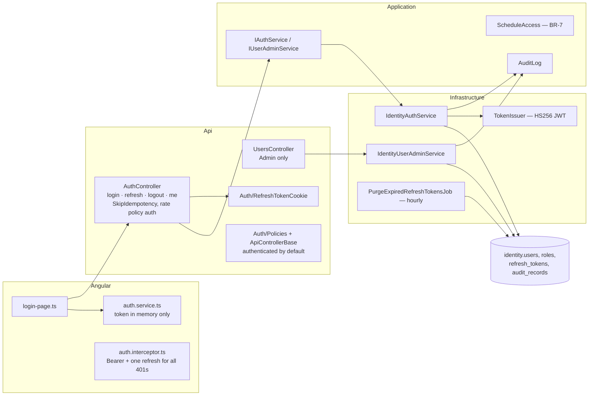
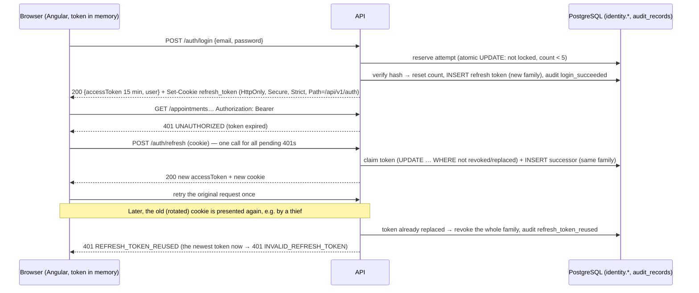
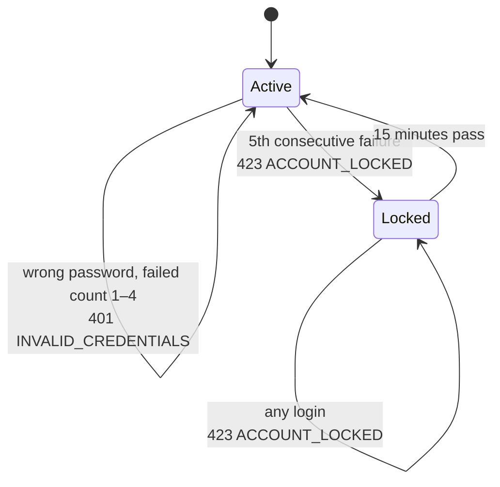
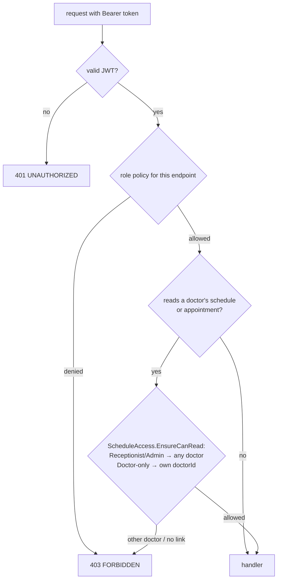
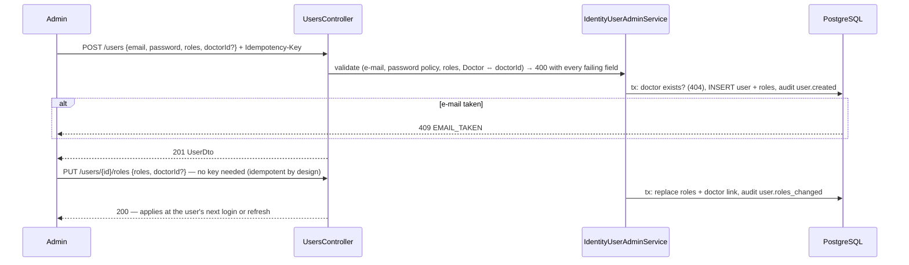

# Authentication, users and audit ✅

Sign-in, short-lived tokens with rotating refresh, roles, the Doctor's own-schedule rule, user admin and the audit trail.
[Spec 004](../specs/004-auth.md) · requirements FR-004-x in
[functional.md](../requirements/functional.md#004--authentication-users-and-audit--spec--architecture) ·
[ADR-0005](../adr/0005-identity-jwt.md), [ADR-0011 audit](../adr/0011-audit-log-table.md),
[ADR-0012 BR-7](../adr/0012-br7-resource-check-in-application.md).

## Components

## Sign-in, refresh rotation and reuse detection

## Account lockout

The attempt is reserved with one atomic `UPDATE`, so parallel guesses can't slip past the counter. The login endpoint also
has its own rate limit: 5 per minute per IP ([rate-limiting.md](rate-limiting.md)).

## Authorization: roles, then BR-7

| Endpoint group | Receptionist | Doctor | Admin |
|---|---|---|---|
| Availability, day schedule, get appointment | ✅ | own doctor only | ✅ |
| Book, cancel, reschedule | ✅ | 403 | ✅ |
| Doctors list, patient search | ✅ | ✅ | ✅ |
| `POST /users`, `PUT /users/{id}/roles` | 403 | 403 | ✅ |

## User admin

## Audit trail
Every row is written by `AuditLog.Record` into the same unit of work as the change, so a rejected change leaves no record.
Rows hold ids only, never names or e-mails (NFR-9).

| Action | When |
|---|---|
| `auth.login_succeeded` / `auth.login_failed` / `auth.logout` / `auth.refresh_token_reused` | sign-in events |
| `appointment.booked` / `appointment.cancelled` / `appointment.rescheduled` | schedule changes |
| `user.created` / `user.roles_changed` | user admin |
