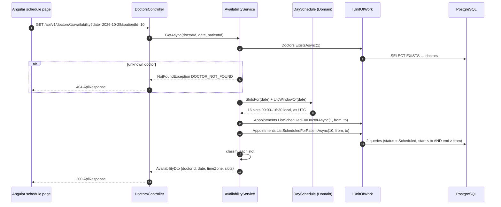
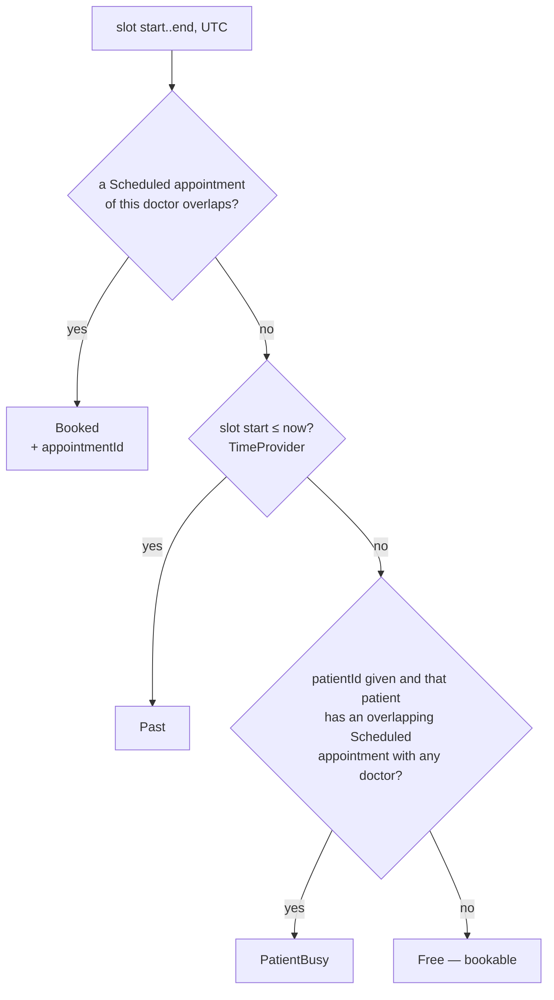
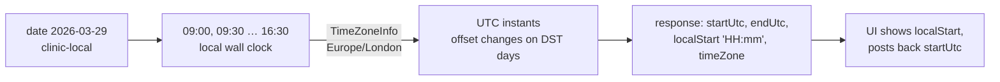

# Availability ✅

Show a doctor's day as bookable slots in the clinic's time zone. [Spec 001](../specs/001-availability.md) ·
requirements FR-001-x in [functional.md](../requirements/functional.md#001--availability--spec--architecture) ·
[ADR-0003 time zones](../adr/0003-time-zones.md).

## Components
| Layer | Piece | Job |
|---|---|---|
| Web | `features/schedule/schedule-page.ts`, `slot-grid.ts` | doctor + date pickers; colours slots; only Free is clickable |
| Api | `Controllers/DoctorsController.cs` → `GET /api/v1/doctors/{id}/availability?date=&patientId=` | bind, call the service, wrap in `ApiResponse` |
| Application | `Availability/AvailabilityService.cs` | doctor exists → slots → two queries → classify |
| Domain | `Scheduling/DaySchedule.cs` | clinic-local slots for a date, converted to UTC (DST-safe); `UtcWindowOf(date)` |
| Infrastructure | `AppointmentRepository.ListScheduledForDoctorAsync` / `…ForPatientAsync`, `DoctorRepository` (`ExistsAsync` from the generic base) | half-open overlap queries, `AsNoTracking` |

## Request flow

Always two appointment queries, however many slots the day has (NFR-2).

## Slot classification

Overlap is half-open, like the exclusion constraints: `a.start < slot.end && a.end > slot.start`, so 09:00–09:30 and
09:30–10:00 never overlap. A cancelled appointment is not *Scheduled*, so its slot shows Free again. `Unavailable`
(holidays, time off, outside working hours) arrives with specs 006/007.

## Time zones

The browser's own time zone never matters ([ADR-0003](../adr/0003-time-zones.md)).
