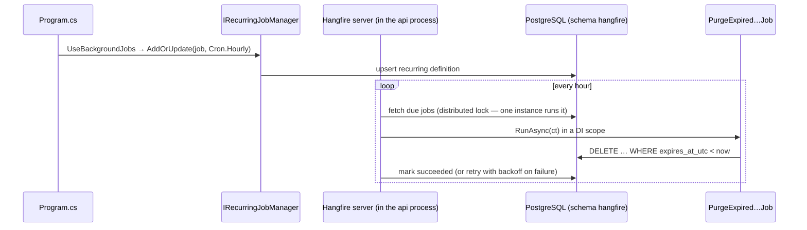
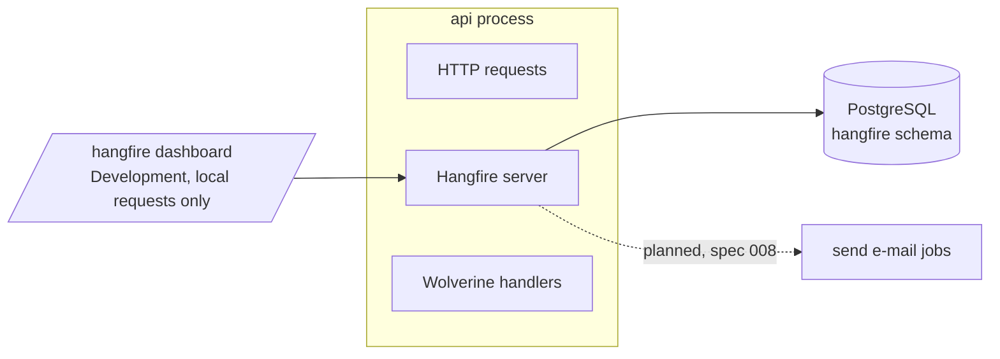

# Background jobs ✅

Recurring housekeeping runs inside the API process with Hangfire, so there is no separate worker to deploy.
[ADR-0014](../adr/0014-hangfire-background-jobs.md).

## Components
| Piece | Job |
|---|---|
| `Infrastructure/BackgroundJobs/BackgroundJobsSetup.cs` | `AddBackgroundJobs` (Hangfire + PostgreSQL storage, schema `hangfire`); `UseBackgroundJobs` registers the recurring jobs and the Development-only dashboard |
| `Infrastructure/Auth/PurgeExpiredRefreshTokensJob.cs` | deletes refresh tokens past expiry (hourly) |
| `Infrastructure/Idempotency/PurgeExpiredIdempotencyRecordsJob.cs` | deletes idempotency records past their 24 h time-to-live (hourly) |
| `BackgroundJobs:Enabled` | `false` turns off the server and the recurring registrations |

## How a recurring job runs

## Where things run

In Docker the dashboard isn't reachable, because it accepts local requests only. Use local development to see it.
