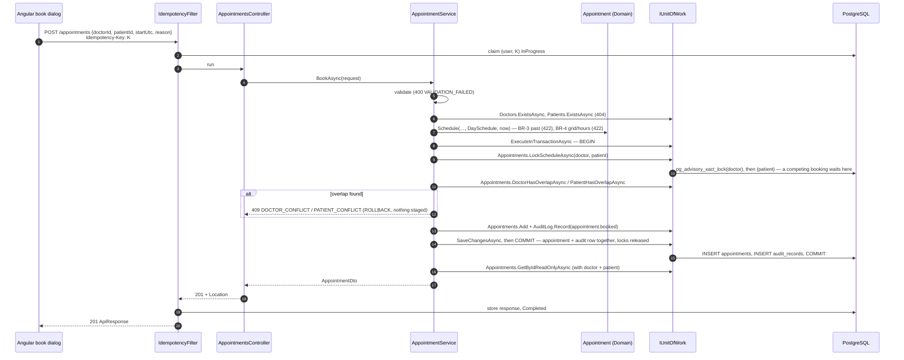
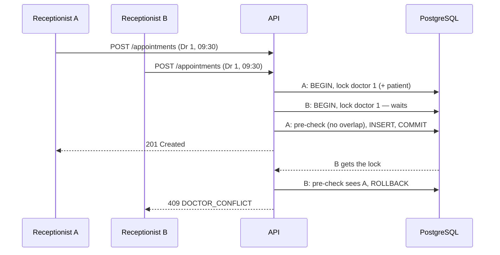
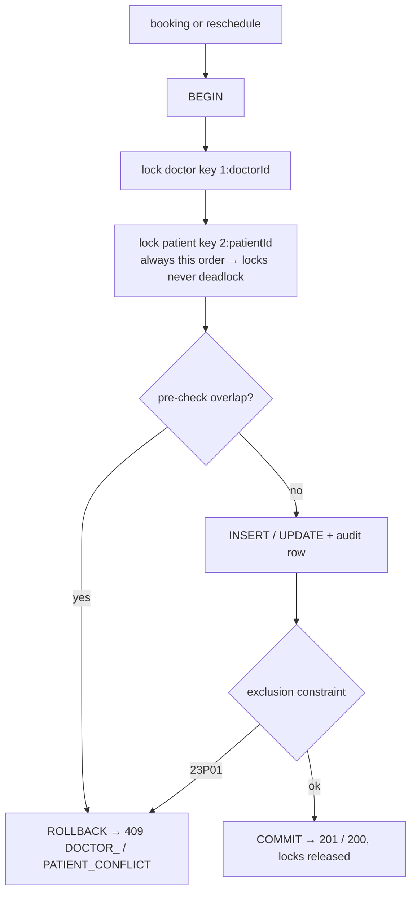
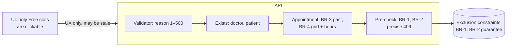

# Booking ✅

Book a free slot for a patient, never double-booking. [Spec 002](../specs/002-booking.md) · requirements FR-002-x in
[functional.md](../requirements/functional.md#002--booking--spec--architecture) ·
[ADR-0002 exclusion constraints](../adr/0002-postgres-exclusion-constraints.md).

## Components
| Layer | Piece | Job |
|---|---|---|
| Web | `features/schedule/book-dialog.ts`; `core/http/idempotency-key.interceptor.ts` | patient search → reason → review → confirm; one `Idempotency-Key` per confirm |
| Api | `Controllers/AppointmentsController.cs` `POST /api/v1/appointments`; `Idempotency/IdempotencyFilter.cs` | replay or run; 201 + `Location` |
| Application | `Appointments/AppointmentService.BookAsync`, `AppointmentValidators.cs`, `ScheduleAccess` | validate → exists → rules → pre-check → stage → one commit |
| Domain | `Appointments/Appointment.Schedule` (BR-3, BR-4 via `DaySchedule`) | the aggregate refuses past or invalid slots |
| Infrastructure | `AppointmentRepository` (`DoctorHasOverlapAsync`, `PatientHasOverlapAsync`, `Add`), `UnitOfWork`, `AppDbContext.SaveChangesAsync` | pre-check queries; 23P01 → 409 |
| Database | `ex_appointments_doctor_overlap`, `ex_appointments_patient_overlap` | the guarantee (BR-1, BR-2) |

## Happy path

## Two receptionists, one slot (NFR-1)

Without the lock, both pre-checks pass and both INSERTs wait on each other inside the exclusion constraint. PostgreSQL
then aborts victims as deadlocks (40P01), one per second: measured 7 of 8 losers as 503 after up to 7 s. With the lock,
the losers queue for milliseconds and get a precise 409 (SPEC §5). The constraint still guarantees correctness for any
write that skips the lock, and if such a write deadlocks, `AppDbContext` maps the 40P01 to 409 `CONCURRENCY_CONFLICT`.

## Where each rule is enforced

