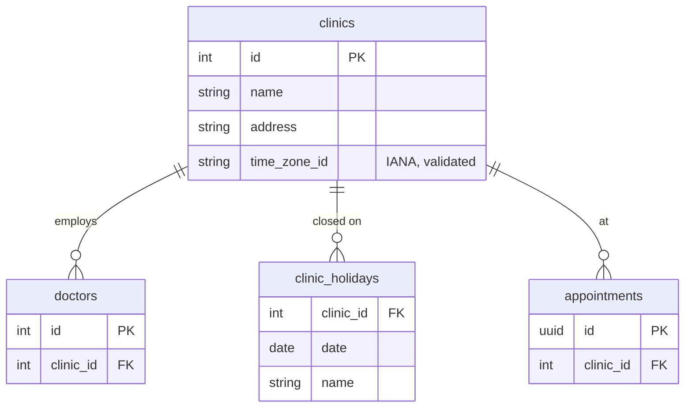
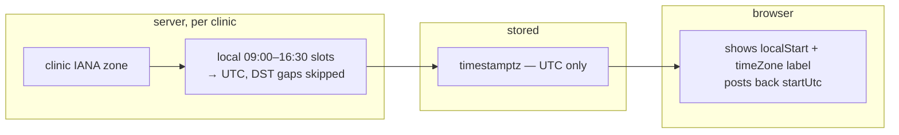

# Clinics and time zones 📋 planned (single clinic built)

Several clinics, each with its own IANA time zone and holidays. Today there is one clinic, configured with `Clinic:TimeZone`
(default `Europe/London`); the DST handling it needs is already built. [Spec 007](../specs/007-clinics-timezones.md) ·
requirements FR-007-x in [functional.md](../requirements/functional.md#007--clinics-time-zones-holidays--spec--architecture) ·
[ADR-0003](../adr/0003-time-zones.md).

## Data (from the spec)

## Time handling (built for one clinic, unchanged with many)

- Appointments in different clinics interact only through BR-2 (the patient can't be in two places), and that is compared
  as UTC ranges.
- On a DST-change date the slots are still 09:00–16:30 local; their UTC offsets differ from the day before
  (`DayScheduleTests.AC_001_6…`).
- A holiday gives `Unavailable` slots for that local date.
