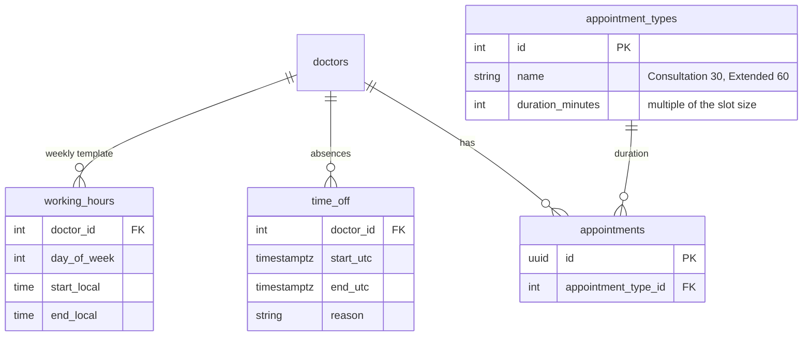
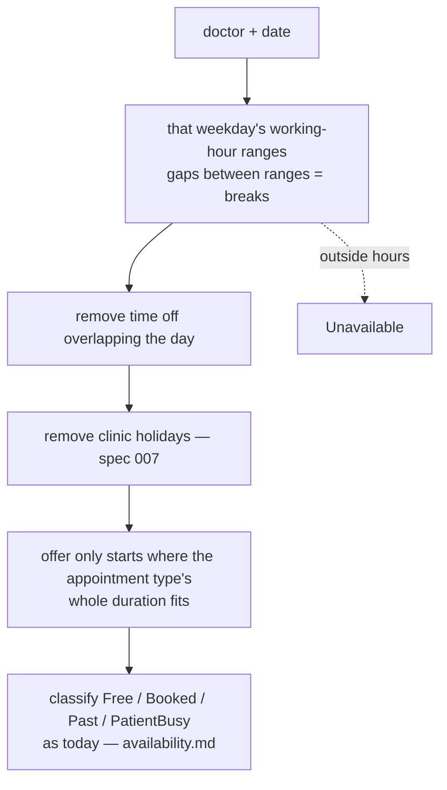

# Doctor schedules 📋 planned

Per-doctor working hours, breaks, time off and appointment types. Today every doctor works the clinic hours from
`Clinic:Open` / `Close` / `SlotMinutes`. [Spec 006](../specs/006-doctor-schedules.md) · requirements FR-006-x in
[functional.md](../requirements/functional.md#006--doctors-working-hours-time-off-appointment-types--spec--architecture).

## Data (from the spec)

## How availability would change

Changing hours never deletes appointments: those now outside hours are flagged `outsideWorkingHours: true` in the day
schedule. The default seed (Mon–Fri 09:00–17:00, 30 minutes) keeps today's behaviour.
