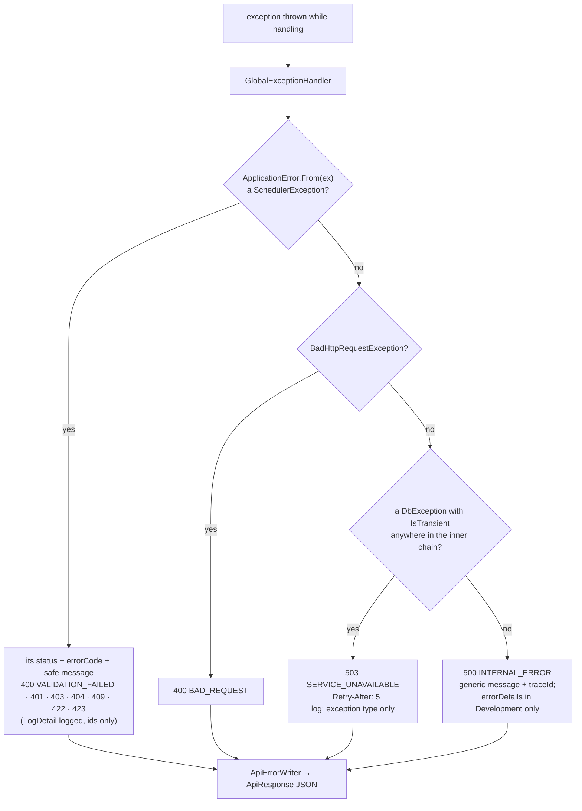
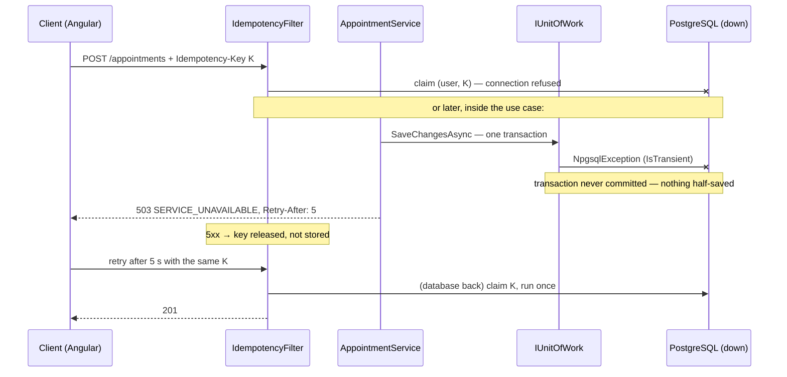

# Errors and resilience ✅

Every failure becomes one predictable `ApiResponse` with a stable `errorCode`, and nothing is ever half-saved.
NFR-7 and NFR-12 in [non-functional.md](../requirements/non-functional.md) · [ADR-0015 envelope](../adr/0015-api-response-envelope.md) ·
[ADR-0008 resilience](../adr/0008-resilience-polly.md).

## The envelope
```jsonc
// success
{ "isSuccess": true, "statusCode": 201, "message": "Appointment booked.", "data": { … }, "timestamp": "…" }
// failure
{ "isSuccess": false, "statusCode": 409, "message": "The doctor already has an appointment at this time.",
  "errorCode": "DOCTOR_CONFLICT", "traceId": "00-…", "timestamp": "…" }
// 400 adds "errors": { "field": ["…"] }; an unexpected 500 adds "errorDetails" in Development only
```
Business codes live in `Domain/Common/ErrorCodes.cs` and transport codes in `Api/Errors/ApiErrorCodes.cs`. The architecture
tests keep them unique and UPPER_SNAKE.

## From exception to response

Errors the framework makes itself take the same shape:
- JWT 401/403 come from the bearer events;
- an unknown route (404) or method (405) goes through `IProblemDetailsWriter` → `ApiResponseProblemDetailsWriter`;
- a non-JSON body (415) goes through `ApiResponseClientErrorFactory`;
- an unknown API version gives 404/400 `UNSUPPORTED_API_VERSION`;
- 429 comes from the rate limiter.

`ErrorStatusMapping` picks their codes.

Database constraint errors are translated before they reach this handler, in `AppDbContext.SaveChangesAsync`:
- exclusion violation 23P01 → 409 `DOCTOR_CONFLICT` / `PATIENT_CONFLICT`;
- a stale `xmin` → 409 `CONCURRENCY_CONFLICT`;
- a deadlock 40P01 → 409 `CONCURRENCY_CONFLICT`. It counts as "transient", but it is a conflict, not an outage, so it
  must not become a 503 (SPEC §5).

## Database outage: atomic, no retry

There is no server-side retry, no EF execution strategy and no Polly pipeline for the database: consistency comes from the
unit of work committing once per use case. Polly is used only for calls to other services (SMTP, outbound HTTP) and for
rate limits. If a commit succeeded but its answer was lost, the retry either replays the stored response (idempotency) or
hits the exclusion constraint (409).

## Resilience by dependency
| Dependency | Failure handling | Status |
|---|---|---|
| PostgreSQL | atomic unit of work; transient failure → 503 + `Retry-After`; the client retries with the same key | ✅ |
| RabbitMQ | degraded mode on the PostgreSQL message store; recovery service re-probes ([messaging.md](messaging.md)) | ✅ |
| Inbound traffic | Polly rate limits → 429 ([rate-limiting.md](rate-limiting.md)) | ✅ |
| SMTP | Polly timeout → retry (exponential + jitter) → circuit breaker | 📋 spec 008 |
| Browser → API | the Angular interceptor retries GETs and keyed POSTs on 0/5xx/429, honouring `Retry-After` | 🟡 per ADR-0008 |
