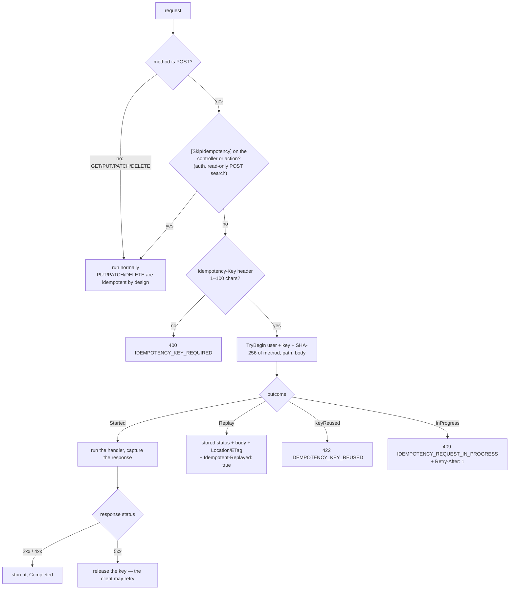
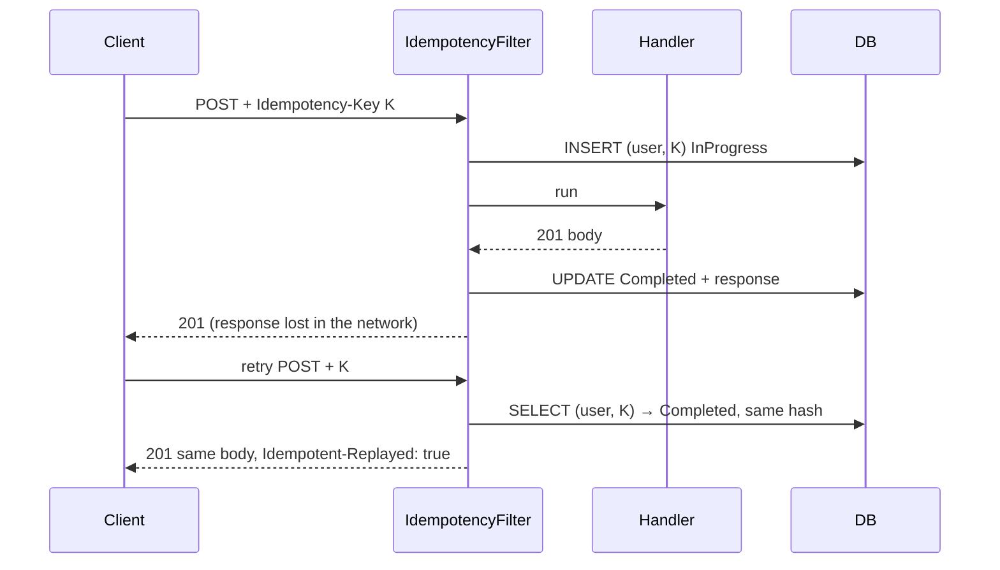
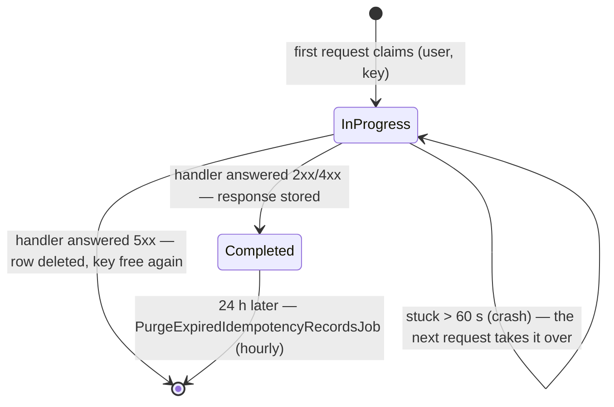

# Idempotent writes ✅

A retried POST returns the first answer instead of doing the work twice. [Spec 009](../specs/009-idempotency.md) ·
requirements FR-009-x in [functional.md](../requirements/functional.md#009--idempotent-writes--spec--architecture) ·
[ADR-0006](../adr/0006-idempotency-records.md) · plan 012 (POST only).

## Components
| Layer | Piece | Job |
|---|---|---|
| Web | `core/http/idempotency-key.interceptor.ts` | a fresh UUID per POST outside `/api/v1/auth/`; registered outside the auth interceptor, so a retry after a token refresh resends the same key |
| Api | `Idempotency/IdempotencyFilter.cs` (global MVC resource filter), `IdempotencyFilter.Applies`, `SkipIdempotencyAttribute`, `RequestFingerprint`, `IdempotencyKeyOperationTransformer` (OpenAPI) | scope, claim, run, store, replay |
| Application | `Idempotency/IIdempotencyStore.cs` | the port |
| Infrastructure | `Idempotency/EfIdempotencyStore.cs`, `IdempotencyRecord`, `PurgeExpiredIdempotencyRecordsJob` | `INSERT … ON CONFLICT (user_id, key) DO NOTHING` as the lock; hourly purge |

## Does this request need a key?

## Lost response, safe retry

## Record lifecycle

Keys are scoped per user, so two users who send the same key never collide.
