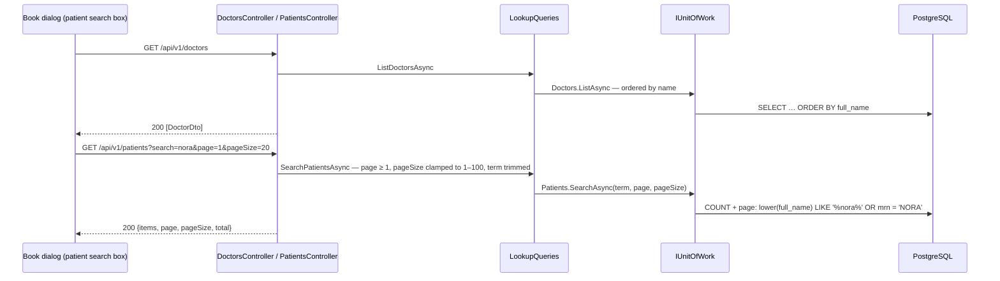
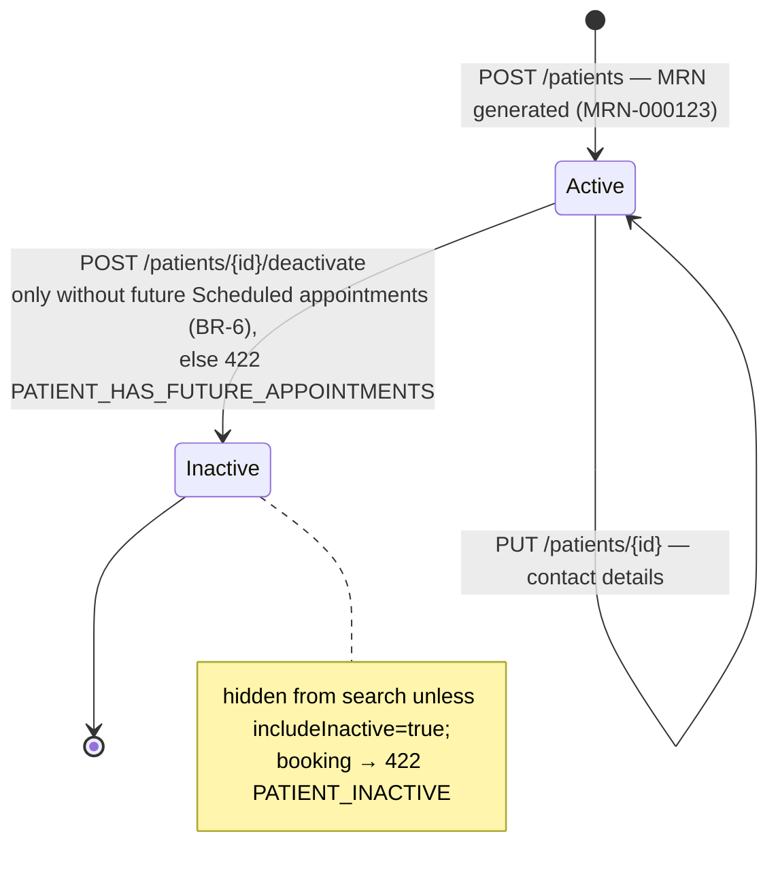

# Doctor and patient lookups 🟡

Read-only lists used to fill pickers: doctors, and a paged patient search. Patient create/update/deactivate is planned.
[Spec 005](../specs/005-patients.md) · requirements FR-005-x in
[functional.md](../requirements/functional.md#005--patients--spec--architecture).

## Components and flow (built)

Both are reads, so no `Idempotency-Key` is needed. If a future search moves to `POST /patients/search` (criteria in the
body), it gets `[SkipIdempotency]` on the action (plan 012).

## Patient lifecycle (planned, spec 005)

