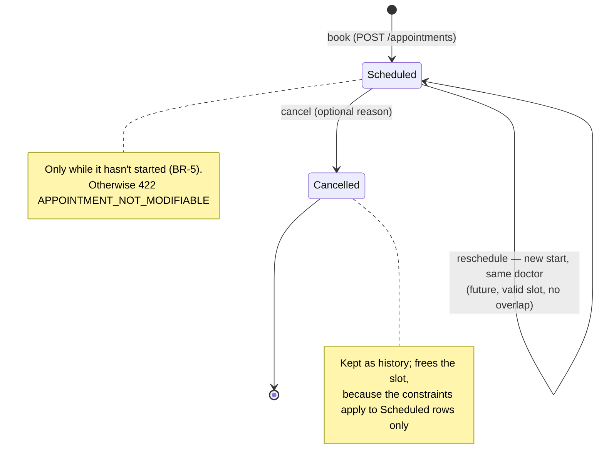
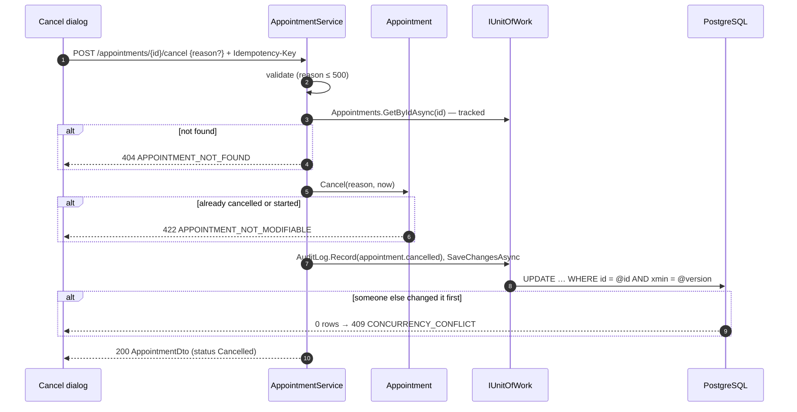
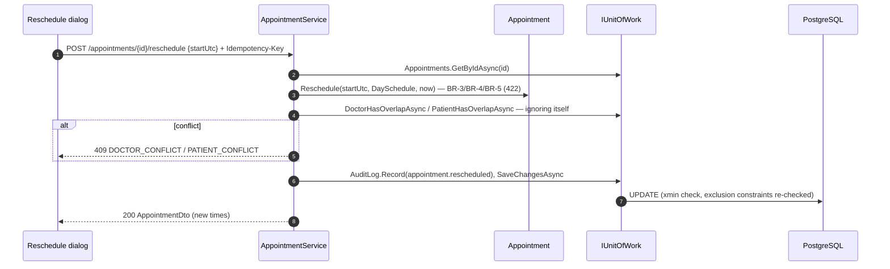
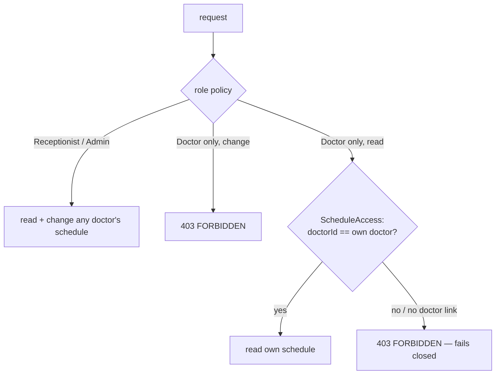

# Manage the day's schedule ✅

See a doctor's day, cancel, reschedule. [Spec 003](../specs/003-manage-schedule.md) · requirements FR-003-x in
[functional.md](../requirements/functional.md#003--manage-the-days-schedule--spec--architecture) ·
[ADR-0004 concurrency](../adr/0004-concurrency-etag.md).

## Components
| Layer | Piece | Job |
|---|---|---|
| Web | `features/schedule/schedule-page.ts`, `doctor-schedule-page.ts`, `cancel-dialog.ts`, `reschedule-dialog.ts` | day list; dialogs; a Doctor sees their own day read-only |
| Api | `AppointmentsController`: `GET /appointments?doctorId=&date=`, `GET /appointments/{id}`, `POST …/{id}/cancel`, `POST …/{id}/reschedule` | thin actions |
| Application | `AppointmentService.GetDayScheduleAsync / GetAsync / CancelAsync / RescheduleAsync`, `ScheduleAccess` | BR-7 read check, rules, one commit with audit |
| Domain | `Appointment.Cancel / Reschedule` | BR-3, BR-4, BR-5 |
| Infrastructure | `AppointmentRepository.ListDayScheduleAsync`, `GetByIdAsync` (tracked, from the generic base + doctor/patient), `OthersOverlapping` | `xmin` concurrency token on update |

## Appointment lifecycle

## Cancel

## Reschedule

The UI's reschedule dialog loads availability with `patientId`, so slots where the patient is busy elsewhere show as
PatientBusy ([availability](availability.md)).

## Who may do what (BR-7)

Details: [auth-and-users.md](auth-and-users.md).
