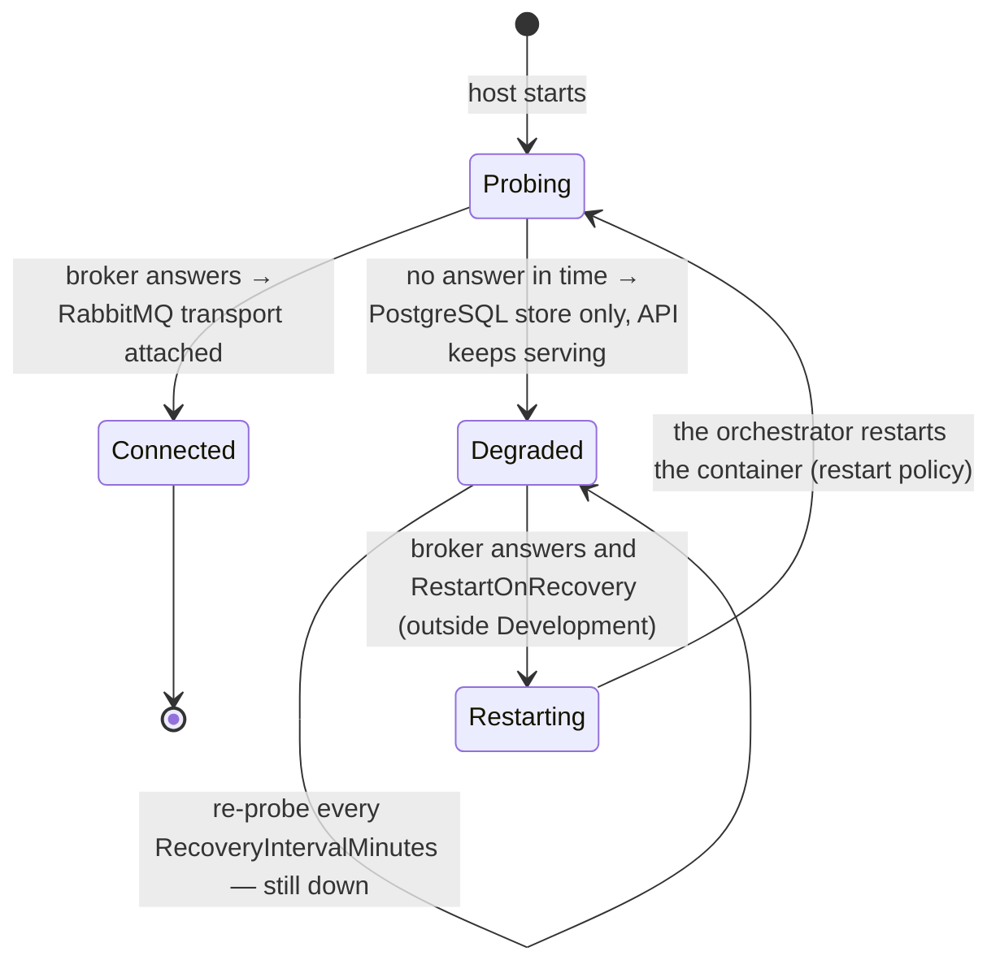
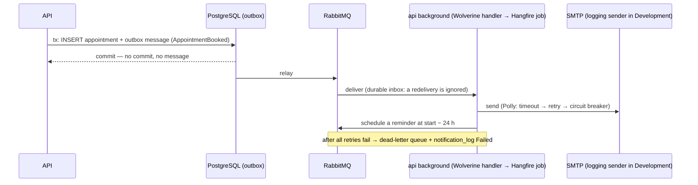

# Messaging and notifications 🟡

Wolverine with a PostgreSQL message store and a RabbitMQ transport is wired and running. The notification e-mails that will
use it are planned. [ADR-0007](../adr/0007-wolverine-outbox-rabbitmq.md) · [Spec 008](../specs/008-notifications.md) ·
requirements FR-008-x in [functional.md](../requirements/functional.md#008--notifications--spec--architecture).

## Components (built)
| Piece | Job |
|---|---|
| `Api/Configuration/MessagingConfig.cs` → `Infrastructure/Messaging/MessagingSetup.cs` | Wolverine: PostgreSQL store (schema `wolverine`), EF Core transactions, a topic exchange `appointment-scheduler.events`, publish rules |
| `RabbitMqAvailability` | startup probe (`ProbeTimeoutSeconds`) |
| `RabbitMqRecoveryService` | in degraded mode, re-probes every `RecoveryIntervalMinutes` and restarts the host when the broker is back (outside Development) |
| `Messaging:RabbitMq:Enabled=false` | store only, never touch a broker |

## Broker availability

In Docker Compose `api` has `restart: unless-stopped`, so a restart re-attaches the transport. In Development it stays
degraded until you restart it yourself.

## Notification flow (planned, spec 008)

One trace covers API → outbox → broker → handler → job → SMTP ([observability.md](observability.md)).
