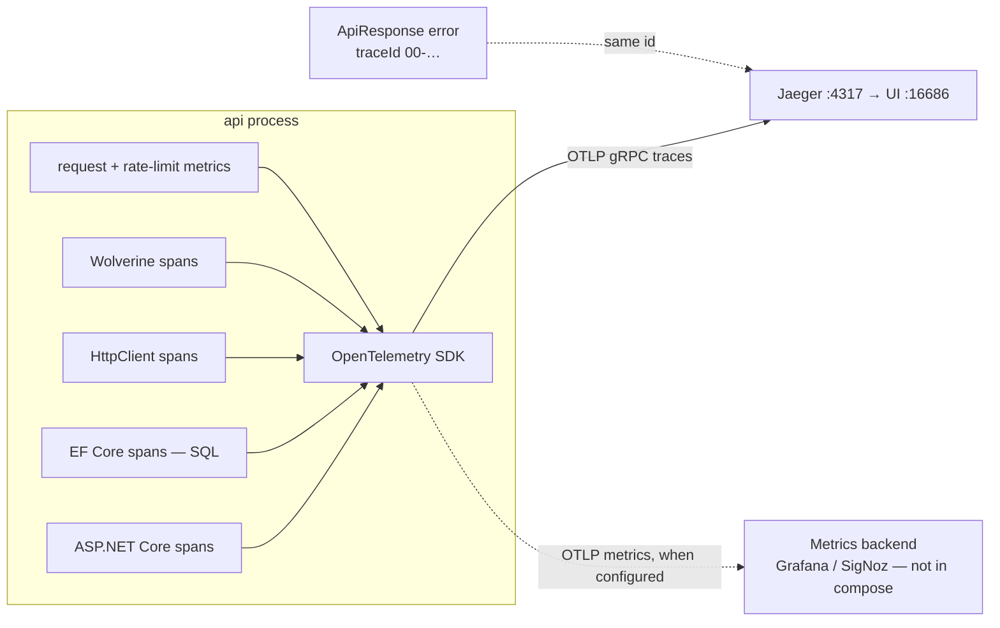
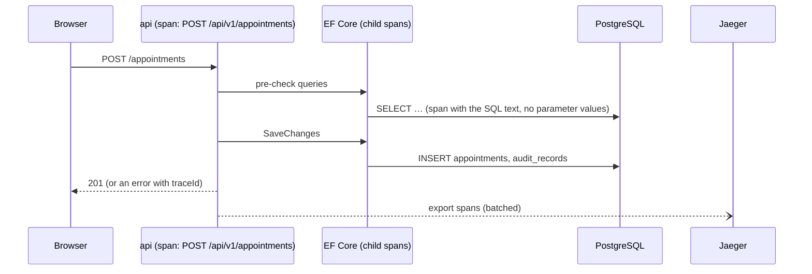

# Observability ✅ (traces) · 🟡 (logs, metrics endpoint)

Find a slow or failing request without guessing. NFR-8 in
[non-functional.md](../requirements/non-functional.md#nfr-8--observability) · [ADR-0010](../adr/0010-observability-otel-jaeger.md).

## Components
| Piece | Job |
|---|---|
| `Api/Configuration/ObservabilityConfig.cs` | OpenTelemetry: resource `appointment-scheduler-api` + `deployment.environment.name`; tracing for ASP.NET Core (health and `/hangfire` filtered out; `enduser.id` = caller's id only), HttpClient, EF Core and the `Wolverine` source; metrics for ASP.NET Core, HttpClient and the `AppointmentScheduler` meter |
| `Observability:OtlpEndpoint` | traces target; Development / Docker → Jaeger `:4317`; empty = no export |
| `Observability:MetricsEndpoint` | metrics target (Jaeger has no metrics); empty = no export |
| `RateLimitMetrics` | `scheduler.rate_limit.rejected{policy}` |
| `ApiResponse.traceId` | the same trace id the client sees in error bodies |

## Signal flow

## One request, one trace

Look a request up in Jaeger by service `appointment-scheduler-api`, or paste an error's `traceId`.

**Still to do (S-60):** structured JSON logs (Serilog) carrying `TraceId`, a `/metrics` endpoint, and `/health/ready`
(database + broker).
