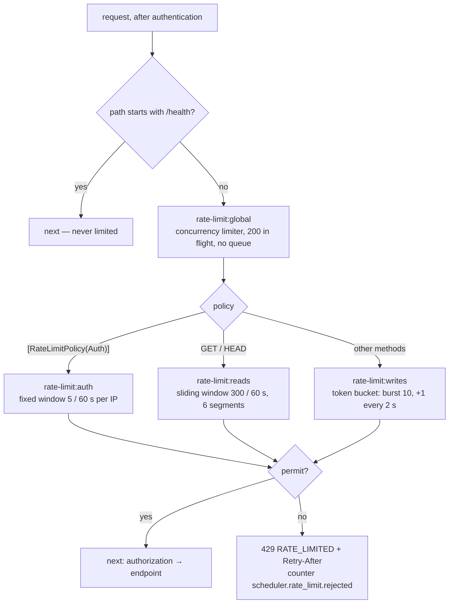
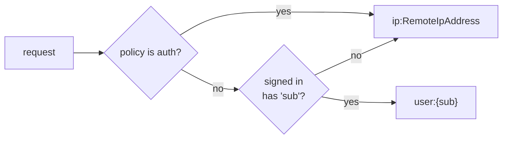

# Rate limiting ✅

Brute-force logins and one busy client must not starve everyone else. NFR-6 in
[non-functional.md](../requirements/non-functional.md#nfr-6--abuse-protection-rate-limits) ·
[ADR-0009](../adr/0009-rate-limiting.md) · [ADR-0008](../adr/0008-resilience-polly.md) (Polly).

## Components
| Piece | Job |
|---|---|
| `Api/Configuration/RateLimitingConfig.cs` | registers the named Polly v8 pipelines from section `RateLimiting`; `UseRateLimitingConfiguration()` adds the middleware when `Enabled` |
| `Api/RateLimiting/PollyRateLimitingMiddleware.cs` | runs after authentication: global pipeline, then the endpoint's policy pipeline |
| `RateLimitPolicies` / `[RateLimitPolicy(...)]` | pipeline names; an action opts into a non-default policy (login and refresh use `auth`) |
| `RateLimitPartitionKey` | who a request counts against: `user:{sub}`, else `ip:{address}`; `auth` is always per IP |
| `RateLimitMetrics` | counter `scheduler.rate_limit.rejected` (tag `policy`) |

## Request flow

## Partitions

Each policy keeps a partitioned limiter (`System.Threading.RateLimiting`), so one user's burst never spends another user's
budget. The partition key travels to the limiter in Polly's `ResilienceContext`.

**Limits.** Counters live in memory per API instance; with several replicas, move the limits to a gateway. Behind a reverse
proxy (the Docker nginx), `RemoteIpAddress` is the proxy's address until `ForwardedHeaders` is added (S-61), so anonymous
clients share one login budget.
