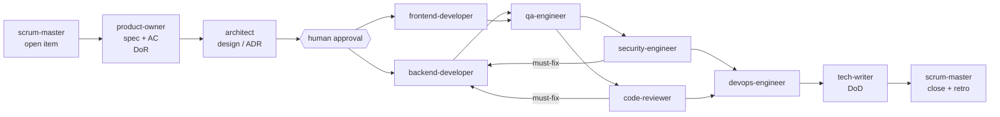

# SDLC — roles, gates and ceremony

Every change flows through role agents in `.claude/agents/`. Agents hand off **through files in the repo**, never chat memory,
so each step is reviewable and survives sessions. Run the flow with `/sdlc <feature>` (full) or `/sdlc --fast <change>` (small).

## Pipeline

`--fast`: product-owner (AC only) → developer → qa-engineer → code-reviewer → tech-writer.

## Roles
| Agent | Produces | Gate |
|---|---|---|
| product-owner | `docs/specs/NNN-*.md`, backlog row | **DoR**: every AC testable (Given/When/Then), BR impact listed, out-of-scope stated, no open questions |
| architect | Design section in spec, ADR when a decision is made | Layer rule respected; NFR impact (auth, idempotency, rate limit, observability, time zones, PII) written down |
| backend-developer | Code + unit tests named after AC IDs (no integration tests, plan 011) | `dotnet build` + `dotnet test` green; no logic in endpoints |
| frontend-developer | Angular feature + Vitest specs | `npm test` + `npm run build` green; accessible controls |
| qa-engineer | Test plan table in spec, missing unit tests, manual checks | Every AC mapped to a passing test or a documented manual check |
| security-engineer | `docs/reviews/NNN-security.md` | No must-fix open (authz, validation, PII, secrets, rate limits, OWASP API Top 10) |
| code-reviewer | `docs/reviews/NNN-code.md` | No must-fix open; ArchitectureTests green |
| devops-engineer | Docker/compose/CI/config, `.env.example`, `operations.md` | `docker compose up` healthy; CI green |
| tech-writer | SPEC.md, README, CHANGELOG, PROMPTS.md entries | **DoD** checklist ticked |
| scrum-master | Backlog status, retro note | Refuses to advance an item whose previous gate lacks evidence |

## Definition of Ready
- [ ] Spec exists from template, status `Refined`
- [ ] AC are numbered, testable, cover errors (4xx) as well as happy path
- [ ] Business rules / NFRs affected are listed
- [ ] Out of scope written

## Definition of Done
- [ ] All AC have passing automated tests (IDs in test names)
- [ ] `dotnet test`, `npm test`, `npm run build` green; ArchitectureTests green
- [ ] Reviews have no open must-fix
- [ ] SPEC.md / spec status / README / CHANGELOG updated; notable prompts logged in PROMPTS.md
- [ ] Spec Status row fully ticked; backlog row `Done`

## Ceremonies (file-based)
- **Sprint planning** — scrum-master moves the next milestone's stories to the active sprint in `docs/backlog.md`.
- **Daily** — each agent appends one status line to the spec it touched.
- **Review / demo** — `/verify` output + screenshots referenced from the backlog item.
- **Retro** — `docs/retros/sprint-N.md`: what worked, what the AI got wrong, which agent/skill instruction to improve. Agreed
  improvements are applied to `.claude/agents/*.md` immediately.
